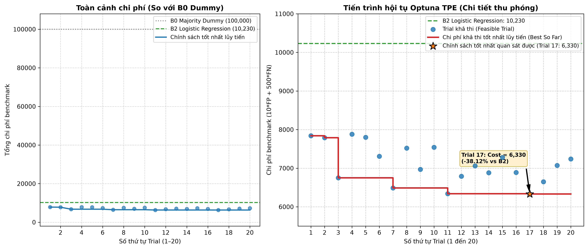
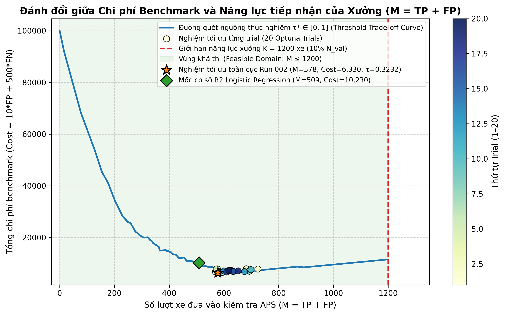

# Tối Ưu Hóa Chi Phí Bảo Trì Dự Đoán Hệ Thống Khí Nén Xe Tải Nặng Scania APS (UCI 421)

[](#)
[](#)
[](https://archive.ics.uci.edu/dataset/421/aps+failure+at+scania+trucks)
[](#)
[](#)
[-success.svg)](#)

> **ĐỒ ÁN MÔN HỌC:** NHẬP MÔN TỐI ƯU HÓA — HỌC KỲ 1, NĂM HỌC 2026–2027  
> **KHOA CÔNG NGHỆ THÔNG TIN — TRƯỜNG ĐẠI HỌC VĂN LANG**  
> **Sinh viên thực hiện:** Huỳnh Phúc (MSSV: 2474802010314)  
> **Mã nguồn Repository:** [PhucHuynh16/Predictive-maintenance-cost-optimization](https://github.com/PhucHuynh16/Predictive-maintenance-cost-optimization)  
> **Sản phẩm bàn giao:** Báo cáo [PDF (10 trang)](report/BAO_CAO_CUOI_KY_SCANIA_APS.pdf) / [Word](report/BAO_CAO_CUOI_KY_SCANIA_APS.docx) | Slide [PDF (8 slide)](slides/SLIDES_THUYET_TRINH_SCANIA_APS.pdf) / [PowerPoint](slides/SLIDES_THUYET_TRINH_SCANIA_APS.pptx) | [Script Demo](scripts/demo.py)

---

## 1. Problem (Đặt Vấn Đề & Bối Cảnh Bài Toán)

Trong ngành vận tải thương mại hạng nặng, sự cố chết máy đột ngột trên đường cao tốc của xe tải gây ra tổn thất kinh tế nghiêm trọng: chi phí cứu hộ đường dài, hư hỏng hàng hóa, chậm trễ lịch trình chuỗi cung ứng và uy tín doanh nghiệp vận tải. Hệ thống cấp khí nén (**Air Pressure System - APS**) chịu trách nhiệm cung cấp khí nén cho hệ thống phanh an toàn và cơ chế sang số của xe tải Scania.

Tuy nhiên, bài toán bảo dưỡng chẩn đoán APS có hai rào cản kỹ thuật đặc thù:
1. **Chi phí phi đối xứng nghiêm ngặt (Asymmetric Cost Matrix):** Bỏ sót một xe sắp hỏng APS dẫn đến chết máy dọc đường gây tổn thất gấp **50 lần** so với chi phí đưa một xe vào xưởng kiểm tra định kỳ không cần thiết.
2. **Ràng buộc công suất xưởng dịch vụ (Workshop Capacity Constraint):** Mỗi trạm bảo dưỡng có giới hạn vật lý về số cầu nâng, thiết bị đo áp suất và thợ máy chuyên trách. Nếu hạ ngưỡng cảnh báo quá thấp để bắt hết lỗi, số lượng xe vào xưởng kiểm tra sẽ bùng nổ, gây tê liệt trạm dịch vụ.

**Câu hỏi tối ưu hóa cốt lõi:** *Làm thế nào để xác định đồng thời siêu tham số mô hình phân loại và ngưỡng can thiệp quyết định nhằm **cực tiểu hóa tổng chi phí bảo trì**, trong khi vẫn **thỏa mãn tuyệt đối giới hạn công suất tiếp nhận của xưởng dịch vụ**?*

---

## 2. Optimization Formulation (Mô Hình Hóa Toán Học)

Bài toán được chuẩn hóa thành bài toán tối ưu hóa phi tuyến có ràng buộc bất đẳng thức:

$$\min_{\theta \in \Theta, \tau \in [0, 1]} \quad f(\theta, \tau) = 10 \cdot FP(\theta, \tau) + 500 \cdot FN(\theta, \tau)$$

$$\text{subject to} \quad M(\theta, \tau) = TP(\theta, \tau) + FP(\theta, \tau) \le K = \left\lfloor \frac{N}{10} \right\rfloor$$

### 2.1. Vector biến quyết định (Decision Variables)
Vector quyết định tổng hợp $x = (\theta, \tau) \in \Omega$ gồm:
- $\theta \in \Theta$: Tập siêu tham số của mô hình học máy (Random Forest), gồm:
  - $n_{\text{estimators}} \in [20, 60]$ (số cây quyết định, bước nhảy 10).
  - $\text{max\_depth} \in [4, 12]$ (độ sâu tối đa của cây).
  - $\text{min\_samples\_split} \in [2, 10]$ (số mẫu tối thiểu để phân tách nút).
  - $\text{max\_features} \in [0.25, 0.50]$ (tỷ lệ thuộc tính ngẫu nhiên tại mỗi nút).
- $\tau \in [0, 1]$: Ngưỡng xác suất phân loại (classification threshold). Quyết định can thiệp $a_i \in \{0, 1\}$ được xác định bởi:
  $$a_i = \mathbb{I}(p_i(\theta) \ge \tau)$$
  trong đó $p_i(\theta) = P(y_i = 1 \mid x_i; \theta)$ là xác suất xe $i$ bị hỏng APS do mô hình dự báo.

### 2.2. Hàm mục tiêu chi phí benchmark (Objective Function)
Theo đặc tả chuẩn công nghiệp từ Scania CV AB và Hội nghị IDA 2016:
- **False Positive (FP):** Can thiệp kiểm tra nhầm xe bị hỏng ở bộ phận khác $\rightarrow$ Chi phí kiểm tra xưởng: **$10$ đơn vị chi phí benchmark**.
- **False Negative (FN):** Bỏ sót xe bị hỏng APS, dẫn đến chết máy dọc đường $\rightarrow$ Chi phí cứu hộ & sửa chữa khẩn cấp: **$500$ đơn vị chi phí benchmark** ($c_{\text{FN}} / c_{\text{FP}} = 50$).
- **True Positive (TP) & True Negative (TN):** $0$ đơn vị chi phí phát sinh thêm.

### 2.3. Ràng buộc năng lực xưởng (Capacity Constraint)
Số lượng xe được điều động vào xưởng bảo dưỡng $M = TP + FP$ không được vượt quá $10\%$ tổng số lượng xe trong mỗi chu kỳ vận hành:
- Trên phân vùng Validation ($N = 12.000$ mẫu): $K_{\text{val}} = \lfloor 12.000 / 10 \rfloor = 1.200$ lượt xe.
- Trên tập Official Test ($N = 16.000$ mẫu): $K_{\text{test}} = \lfloor 16.000 / 10 \rfloor = 1.600$ lượt xe.

### 2.4. Bản chất đánh đổi tối ưu (Trade-off Analysis)
- Theo lý thuyết phân loại Bayes không ràng buộc, ngưỡng chi phí tối ưu là $\tau^*_{\text{Bayes}} = \frac{c_{\text{FP}}}{c_{\text{FP}} + c_{\text{FN}}} = \frac{10}{510} \approx 0.0196$.
- Tuy nhiên, trong điều kiện có ràng buộc công suất $M \le K$, việc áp dụng $\tau = 0.0196$ có thể làm bùng nổ số lượng cảnh báo giả $FP$, khiến $M > K$ (vi phạm miền khả thi). Do đó, nghiệm tối ưu thực tế phải là nghiệm thỏa mãn đồng thời cả hàm chi phí và ràng buộc tài nguyên.

---

## 3. Dataset (Bộ Dữ Liệu & Giao Thức Phòng Chống Rò Rỉ)

- **Tên tập dữ liệu:** *APS Failure at Scania Trucks* (UCI Machine Learning Repository #421, [DOI: 10.24432/C51S51](https://doi.org/10.24432/C51S51)).
- **Đặc trưng:** 170 thuộc tính số học ẩn danh (`aa_000` đến `ee_000`), chứa nhiều họ cảm biến phân bố histogram và tỷ lệ giá trị khuyết thiếu cao (ký hiệu `na`).
- **Ngữ nghĩa lớp nhãn chuẩn UCI:**
  - Lớp dương ($y=1$, `pos`): Xe vào xưởng do hỏng hóc thực tế tại hệ thống khí nén APS ($1.67\%$).
  - Lớp âm ($y=0$, `neg`): Xe vào xưởng do hỏng hóc ở các **bộ phận KHÁC** ngoài APS ($98.33\%$).

### Giao thức phân vùng dữ liệu đã khóa (Locked G3 Data Protocol)
- **Tập Train (48.000 mẫu):** 800 ca dương tính ($1.67\%$), 47.200 ca âm tính ($98.33\%$). Dùng độc quyền để fit tiền xử lý và huấn luyện mô hình.
- **Tập Validation (12.000 mẫu):** 200 ca dương tính ($1.67\%$), 11.800 ca âm tính ($98.33\%$). Dùng độc quyền để tìm kiếm siêu tham số và quét ngưỡng tối ưu.
- **Tập Official Test (16.000 mẫu):** 375 ca dương tính ($2.34\%$), 15.625 ca âm tính ($97.66\%$). Được niêm phong độc lập trong suốt quá trình huấn luyện và tối ưu hóa Phase 2; chỉ được giải phóng đánh giá đúng 1 lần duy nhất tại **Gate G10 Run 003** (zero-tuning, zero data leakage).
- **Tiền xử lý không rò rỉ (Strict Train-Only Fitting):** `SimpleImputer(strategy='median')` và `StandardScaler()` fit tham số duy nhất trên 48.000 mẫu Train, sau đó áp dụng biến đổi tĩnh (`transform`) lên Validation và Test.
- Chi tiết nguồn gốc dữ liệu được tài liệu hóa đầy đủ tại [`data/README.md`](data/README.md).

---

## 4. Method (Phương Pháp Đường Cơ Sở & Giải Thuật Tối Ưu)

### 4.1. Hệ thống mô hình đường cơ sở (G4 Baselines)
Để thiết lập mốc so sánh khoa học công bằng, nghiên cứu xây dựng 3 mô hình cơ sở:
1. **B0 (Majority Dummy):** Luôn dự đoán $a_i = 0$ (không can thiệp gì). Thiết lập mức chi phí trần khi bỏ mặc toàn bộ hư hỏng ($500 \times 200 = 100.000$ đơn vị trên Validation).
2. **B1 (Decision Stump):** Cây quyết định 1 tầng (`max_depth=1`, thuộc tính quan trọng nhất `aa_000`). Đánh giá tại ngưỡng chuẩn $0.5$ và ngưỡng Bayes $0.0196$.
3. **B2 (Logistic Regression):** Mô hình tuyến tính chuẩn tắc sau chuẩn hóa (`solver='lbfgs'`, `max_iter=2000`). Đạt chi phí tốt nhất G4: **$C^*_{\text{G4}} = 10.230$ đơn vị chi phí** tại $\tau = 0.0196$.

### 4.2. Phương pháp tối ưu hóa chính (Phase 2: Random Forest + Optuna TPE)
- **Bộ tối ưu siêu tham số:** Sử dụng thuật toán Bayesian Optimization qua **Tree-structured Parzen Estimator (Optuna TPESampler, seed=42)**.
- **Ngân sách thực nghiệm:** 20 trials tuần tự, 1 native thread (`threadpoolctl`), trần bộ nhớ 2048 MB và thời gian tối đa 900 giây dưới sự giám sát nghiêm ngặt của Windows Job Object.
- **Quét ngưỡng quyết định vector hóa (Vectorized Threshold Tuning):** Tại mỗi trial, xác suất dự báo trên Validation được đánh giá qua lưới 101 điểm ngưỡng $\tau \in [0.00, 1.00]$ (bước nhảy $0.01$) để tìm ra cặp $(\theta, \tau^*)$ có chi phí thấp nhất thỏa mãn $M \le 1.200$.

---

## 5. Key Results (Kết Quả Thực Nghiệm Chính & Đồ Thị Minh Họa)

### 5.1. Bảng so sánh tổng hợp qua các giai đoạn nghiên cứu

| Tiêu chí đo đạc | G4 B0: Majority Dummy | G4 B1: Decision Stump | G4 B2: Logistic Reg. | **Phase 2: RF + Optuna (Trial 16)** | **Gate G10: Official Test (Độc lập)** |
|---|:---:|:---:|:---:|:---:|:---:|
| **Phân vùng dữ liệu** | Validation | Validation | Validation | **Validation** | **Official Test (G10 Run 003)** |
| **Quy mô quan sát ($N$)** | 12.000 | 12.000 | 12.000 | **12.000** | **16.000** |
| **Số ca lỗi APS thực tế ($P$)**| 200 ($1.67\%$) | 200 ($1.67\%$) | 200 ($1.67\%$) | **200 ($1.67\%$)** | **375 ($2.34\%$)** |
| **Ngưỡng quyết định $\tau$** | N/A | $0.0196$ | $0.0196$ | $\mathbf{0.3232}$ | $\mathbf{0.3232}$ (Đóng băng) |
| **True Positives (TP)** | 0 | 160 | 186 | **195** ($97.50\%$) | **357** |
| **False Positives (FP)** | 0 | 253 | 323 | **383** | **484** |
| **False Negatives (FN)** | 200 | 40 | 14 | **5** (Chỉ lọt 5 ca) | **18** (Chỉ lọt 18 ca) |
| **True Negatives (TN)** | 11.800 | 11.547 | 11.477 | **11.417** | **15.141** |
| **Độ nhạy (Recall)** | 0.00% | 80.00% | 93.00% | $\mathbf{97.50\%}$ | $\mathbf{95.20\%}$ ($357/375$) |
| **Độ chính xác (Precision)** | N/A | 38.74% | 36.54% | $\mathbf{33.74\%}$ | $\mathbf{42.45\%}$ ($357/841$) |
| **Độ đặc hiệu (Specificity)** | 100.00% | 97.86% | 97.26% | $\mathbf{96.75\%}$ | $\mathbf{96.90\%}$ ($15.1k/15.6k$) |
| **ROC-AUC / PR-AUC** | N/A | 0.8893 / 0.3133 | 0.9825 / 0.7558 | $\mathbf{0.9903 / 0.7059}$ | $\mathbf{0.9861 / 0.7495}$ |
| **Chi phí kiểm tra ($10 \times FP$)** | 0 | 2.530 | 3.230 | **3.830** | **4.840** |
| **Chi phí sự cố ($500 \times FN$)** | 100.000 | 20.000 | 7.000 | **2.500** | **9.000** |
| **TỔNG CHI PHÍ BENCHMARK** | **100.000** | **22.530** | **10.230** | $\mathbf{6.330}$ | $\mathbf{13.840}$ |
| **Số xe vào xưởng ($M$)** | 0 | 413 | 509 | **578** (Giới hạn $1.200$) | **841** (Giới hạn $1.600$) |
| **Trạng thái ràng buộc** | FEASIBLE | FEASIBLE | FEASIBLE | **FEASIBLE (Dư 622)** | **FEASIBLE (Dư 759)** |
| **Mức tiết kiệm vs B0 Dummy** | 0.00% (Chuẩn) | 77.47% | 89.77% | $\mathbf{93.67\%}$ | $\mathbf{92.62\%}$ (Tiết kiệm $173.660$) |
| **Mức giảm chi phí vs B2** | N/A | Tăng $+12.300$ | Mốc chuẩn G4 | **Giảm $-38.12\%$ ($-3.900$)**| N/A |

### 5.2. Hai đồ thị tối ưu hóa cốt lõi (Embedded Figures)

#### Hình 1: Tiến trình hội tụ của thuật toán tối ưu Bayesian Optuna TPE (20 Trials)
Đồ thị thể hiện chi phí từng trial và đường bao nghiệm tốt nhất quan sát được (best-so-far), hội tụ từ mức $7.840$ ở Trial 0 xuống mức tối ưu khả thi $6.330$ tại Trial 16:



#### Hình 2: Đường cong đánh đổi giữa Chi phí và Giới hạn Năng lực Tiếp nhận của Xưởng
Đồ thị quét ngưỡng 101 điểm thực nghiệm minh chứng mối quan hệ phi tuyến giữa ngưỡng phân loại $\tau$, số lượng xe vào xưởng $M$, chi phí False Positive ($10 \times FP$) và chi phí False Negative ($500 \times FN$). Đường giới hạn đỏ thể hiện trần công suất xưởng $K = 1.200$ xe:



### 5.3. Phân tích độ nhạy và tính ổn định (Sensitivity & Stability Analysis)
1. **Tính ổn định của vùng lòng chảo chi phí (Flat Cost Basin):**
   - Trong khoảng ngưỡng $\tau \in [0.20, 0.35]$, tổng chi phí biến động rất nhỏ quanh mức $[6.330, 7.000]$ đơn vị. Điều này mang lại sự an toàn thực tế cao khi triển khai, vì nếu xác suất dự báo bị trôi nhẹ (distribution shift), hệ thống vẫn duy trì chi phí xấp xỉ tối ưu.
2. **Độ nhạy ở hai vùng biên nguy hiểm:**
   - Khi $\tau < 0.10$: Cảnh báo giả $FP$ tăng vọt, số lượng xe vào kiểm tra vượt ngưỡng $1.200$ lượt xe $\rightarrow$ **Vi phạm ràng buộc công suất xưởng (Infeasible)**.
   - Khi $\tau > 0.50$: Bỏ sót sự cố $FN$ tăng nhanh, nhân với hệ số phạt $500$ khiến tổng chi phí tăng phi mã vượt mức $15.000+$ đơn vị.
3. **Độ bền vững trước sự dịch chuyển phân bố dữ liệu (Generalization Stability):**
   - Khi chuyển sang tập Official Test (tỷ lệ lỗi dương tính thực tế tăng từ $1.67\%$ lên $2.34\%$), chính sách đóng băng Trial 16 vẫn duy trì Recall ấn tượng **$95.20\%$** (bắt đúng 357/375 ca lỗi), Precision tăng từ $33.74\%$ lên **$42.45\%$**, và chi phí đạt **$13.840$** (tiết kiệm **$92.62\%$** so với mốc không can thiệp $187.500$). Ràng buộc công suất xưởng kiểm soát chặt ở mức 841 xe ($5.26\% \le 10\%$).

---

## 6. How to Run (Hướng Dẫn Thiết Lập Môi Trường & Tái Lập Kết Quả)

### 6.1. Yêu cầu hệ thống & Môi trường Python 3.11
- Hệ điều hành: Windows 10/11 hoặc Linux (Ubuntu 22.04+).
- Python: **Phiên bản 3.11.x** (đã kiểm định thực tế trên Python 3.11.9).
- Bộ nhớ RAM: Khuyến nghị tối thiểu 4 GB (tiến trình chỉ sử dụng tối đa ~202 MB).

```powershell
# 1. Tạo môi trường ảo Python 3.11
python -m venv venv
.\venv\Scripts\Activate.ps1   # Trên Linux: source venv/bin/activate

# 2. Cài đặt các gói phụ thuộc chuẩn tắc
pip install -r requirements.txt
```

### 6.2. Chạy Demo bảo vệ nhanh trong 2 giây (Zero-Fit, Read-Only)
Script demo được thiết kế để phục vụ buổi bảo vệ 5–7 phút của sinh viên: đọc dữ liệu đã nghiệm thu, hiển thị toàn bộ bảng so sánh, ma trận nhầm lẫn, speaker notes và kiểm tra chữ ký băm mật mã học mà không cần fit lại mô hình hay chạm vào tập Test:

```powershell
# Chạy toàn bộ quy trình demo và in speaker notes
python scripts/demo.py

# Hoặc chỉ in bảng tóm tắt kết quả
python scripts/demo.py --summary

# Hoặc chỉ xác thực chữ ký số SHA-256
python scripts/demo.py --verify
```

### 6.3. Xác thực tính toàn vẹn chữ ký số SHA-256 các artifact nghiệm thu
```powershell
# Kiểm chứng 12 artifacts Phase 2 (Run 002)
python -c "from src.scania.phase2_executor import verify_phase2_run; assert verify_phase2_run('results/scania_aps/phase2/scania_phase2_rf_optuna_002') == True; print('[PASS] Phase 2 Run 002 verified!')"

# Kiểm chứng 9 artifacts Gate G10 Official Test (Run 003)
python scripts/run_scania_g10.py verify
```

### 6.4. Chạy toàn bộ 42 bài kiểm thử tự động (Automated Unit Tests)
```powershell
pytest tests/scania/test_phase2_optimization.py tests/scania/test_g10_evaluation.py -v
```

### 6.5. Tái tạo hai đồ thị tối ưu hóa từ dữ liệu gốc
```powershell
python -m scripts.run_scania_phase2 generate-figures --run-id scania_phase2_rf_optuna_002
```

---

## 7. Repository Structure (Cấu Trúc Thư Mục Dự Án)

Cấu trúc repository tuân thủ nghiêm ngặt theo hướng dẫn chuẩn của Học phần Nhập môn Tối ưu hóa:

```
Predictive-maintenance-cost-optimization/
├── README.md                                # Tài liệu tổng quan portfolio chuẩn rubric
├── requirements.txt                         # Danh mục thư viện phụ thuộc Python 3.11
├── .gitignore                               # Quy tắc loại trừ tệp rác, cache và dữ liệu lớn
│
├── configs/                                 # Cấu hình khóa cố định
│   └── scania/
│       ├── baselines.yaml                   # Cấu hình G4 Baselines (B0, B1, B2)
│       ├── phase2_optimization.yaml         # Cấu hình không gian tìm kiếm Optuna TPE
│       └── g10_official_test.yaml           # Cấu hình đánh giá Official Test Gate G10
│
├── data/
│   └── README.md                            # Đặc tả nguồn gốc, checksums & quy trình tải UCI 421
│
├── docs/                                    # Hồ sơ học thuật và báo cáo kỹ thuật
│   ├── problem_formulation.md               # Mô hình hóa toán học chi tiết
│   ├── experimental_protocol.md             # Giao thức thực nghiệm và ranh giới dữ liệu
│   ├── results_analysis.md                  # Phân tích kết quả chuyên sâu qua các giai đoạn
│   └── reproducibility_evidence.md          # Toàn bộ danh mục chữ ký băm SHA-256 các runs
│
├── figures/                                 # Đồ thị thực nghiệm chất lượng cao (300 DPI)
│   └── optimization/
│       ├── optimization_convergence.png     # Đồ thị 1: Tiến trình hội tụ Optuna TPE
│       └── cost_vs_capacity_tradeoff.png    # Đồ thị 2: Đánh đổi chi phí & năng lực xưởng
│
├── report/                                  # Báo cáo tổng kết đồ án chính thức
│   ├── BAO_CAO_CUOI_KY_SCANIA_APS.md        # Bản thảo Markdown đầy đủ công thức & bảng
│   ├── BAO_CAO_CUOI_KY_SCANIA_APS.docx      # Bản Word chuẩn A4
│   └── BAO_CAO_CUOI_KY_SCANIA_APS.pdf       # Bản PDF xuất bản chính thức (10 trang)
│
├── slides/                                  # Slide thuyết trình bảo vệ đồ án
│   ├── SLIDES_THUYET_TRINH_SCANIA_APS.md    # Đề cương slide & kịch bản thuyết minh
│   ├── SLIDES_THUYET_TRINH_SCANIA_APS.pptx  # Bản PowerPoint Widescreen 16:9 (8 slide)
│   └── SLIDES_THUYET_TRINH_SCANIA_APS.pdf   # Bản PDF trình chiếu (8 slide)
│
├── scripts/                                 # Mã nguồn điều phối thực nghiệm & demo
│   ├── demo.py                              # Entrypoint demo 5-7 phút phục vụ bảo vệ
│   ├── run_scania_phase2.py                 # Runner CLI tối ưu hóa Phase 2 & xuất đồ thị
│   └── run_scania_g10.py                    # Runner CLI đánh giá độc lập Gate G10
│
├── src/                                     # Module logic nghiệp vụ lõi
│   └── scania/
│       ├── phase2_executor.py               # Quản lý supervisor/worker, Optuna, Job Object
│       ├── g10_evaluator.py                 # Evaluator độc lập cho Gate G10
│       └── g10_prewarm.py                   # Pre-import an toàn môi trường kiểm thử
│
├── tests/                                   # Bộ kiểm thử tự động (42 tests)
│   └── scania/
│       ├── test_phase2_optimization.py      # 28 bài test tối ưu hóa & giám sát tài nguyên
│       └── test_g10_evaluation.py           # 14 bài test kiểm định ranh giới Gate G10
│
└── results/                                 # Toàn bộ dữ liệu logs, JSON và checksums thực nghiệm
    └── scania_aps/
        ├── g4/scania_g4_b2_real_002/        # 11 artifacts chính thức G4 Baselines
        ├── phase2/scania_phase2_rf_optuna_002/ # 12 artifacts chính thức Phase 2
        └── g10/scania_g10_official_test_003/   # 9 artifacts chính thức Gate G10
```

---

## 8. Limitations (Hạn Chế Nghiên Cứu & Phân Biệt Benchmark vs Thực Tế)

1. **Phân biệt chuẩn Benchmark tĩnh và Vận hành thực tế tại đội xe:**
   - Hàm chi phí $10 \cdot FP + 500 \cdot FN$ là quy ước chuẩn hóa tĩnh của bài toán benchmark Scania IDA 2016 trên tập dữ liệu lịch sử.
   - Khi áp dụng thực tế trên đội xe vận tải thực địa, chi phí bảo trì thực tế còn chịu tác động của nhiều yếu tố động phức tạp: mô hình điều độ xưởng động (dynamic scheduling), biến động đơn giá nhân công theo giờ và ca làm việc, sự sẵn có và độ trễ chuỗi cung ứng phụ tùng thay thế, chi phí cứu hộ đường bộ biến thiên theo khoảng cách địa lý, và thời gian xe phải ngừng hoạt động (downtime cost).
2. **Giả định về giới hạn công suất xưởng:**
   - Ngưỡng tiếp nhận tối đa $10\%$ ($M \le 1.200$ trên Validation và $M \le 1.600$ trên Test) là một giả định kịch bản vận hành thực nghiệm hợp lý được thiết lập để bài toán tối ưu hóa có ràng buộc mang tính thực tiễn công nghiệp.
3. **Giới hạn ngân sách tìm kiếm siêu tham số:**
   - Ngân sách tối ưu hóa được khóa ở 20 trials tuần tự nhằm tuân thủ nghiêm ngặt điều kiện an toàn tài nguyên (1 thread, trần 900 giây) trên môi trường máy tính cá nhân.
4. **Minh bạch lịch sử tiền kiểm tra Gate G10:**
   - Toàn bộ các lần chạy sự cố trước đó (`scania_g10_official_test_001` và `002`) đều được lưu trữ nguyên vẹn kèm biên bản pháp y. Trong các lần chạy này, tệp test CSV được đọc vào RAM nhưng tiến trình dừng ngay tại chốt kiểm tra preprocessor; tuyệt đối không có bước tính toán dự đoán hay tinh chỉnh nào diễn ra trên dữ liệu Test.

---

## 9. AI Assistance (Khai Báo Công Cụ Hỗ Trợ AI)

Tuân thủ quy định tại **Mục 10 của Đề bài tập lớn cá nhân** (`DE_BAI_TAP_LON_CA_NHAN_5_TUAN_GITHUB_PORTFOLIO.pdf`):

- **Công cụ AI hỗ trợ:** Đề tài có sử dụng các trợ lý trí tuệ nhân tạo (Codex và Google Antigravity) để hỗ trợ:
  - Rà soát mã nguồn và thiết kế các ca kiểm thử đơn vị tự động (42 unit tests trong `tests/scania/`).
  - Hỗ trợ xây dựng khung điều phối tiến trình an toàn qua Windows Job Object và lệnh dòng lệnh CLI.
  - Hỗ trợ định dạng tài liệu báo cáo Markdown/DOCX/PDF và slide thuyết trình.
- **Phần sinh viên tự thực hiện và chịu trách nhiệm học thuật hoàn toàn:**
  - Lựa chọn đề tài, khảo sát ngữ nghĩa nhãn lớp âm tính theo tài liệu Scania CV AB (IDA 2016).
  - Thiết lập công thức toán học hàm mục tiêu chi phí phi đối xứng và ràng buộc năng lực xưởng $M \le K$.
  - Thiết kế và giám sát quy trình phân vùng dữ liệu không rò rỉ (Strict Train-Only Fitting).
  - Phân tích ý nghĩa kinh tế - kỹ thuật của các kết quả thực nghiệm, tính ổn định của vùng lòng chảo chi phí và khả năng khái quát hóa trên tập Official Test.
  - Toàn bộ số liệu và bằng chứng thực nghiệm được sinh ra từ mã nguồn thực tế và được chứng thực toàn vẹn bằng chữ ký số SHA-256 trên repository công khai.
