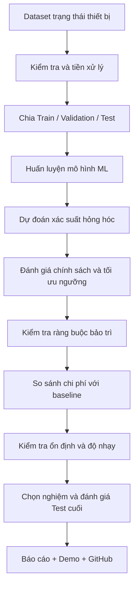
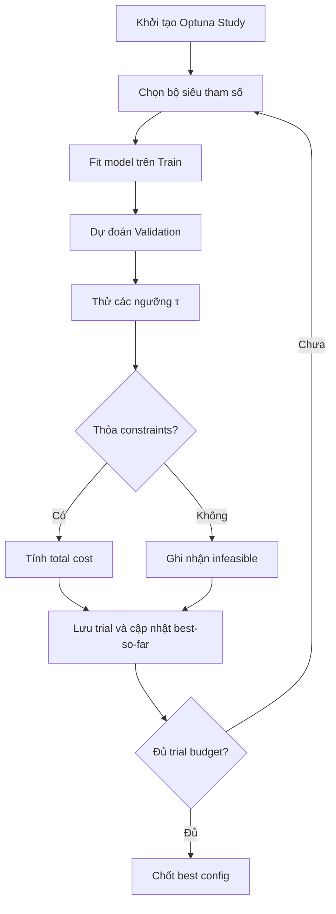

# LỘ TRÌNH THỰC HIỆN ĐỒ ÁN

## Tối ưu chi phí bảo trì dự đoán bằng Machine Learning

**Tên tiếng Anh:** *Optimization of Predictive Maintenance Costs Using Machine Learning*  
**Môn học:** Nhập môn tối ưu hóa  
**Đơn vị:** Khoa Công nghệ thông tin, Trường Đại học Văn Lang  
**Hình thức dự kiến:** Bài tập lớn cá nhân  
**Thời gian:** 05 tuần (35 ngày)  
**Mục tiêu cuối:** Xây dựng một dự án GitHub Portfolio công khai, có thể tái lập, chứng minh được lợi ích của việc tối ưu chính sách bảo trì thông qua thực nghiệm định lượng.

> **Định hướng quan trọng:** Đề tài **không chỉ huấn luyện mô hình dự đoán hỏng hóc**. Phần trung tâm là xác định **biến quyết định, hàm mục tiêu chi phí, các ràng buộc**, xây dựng **baseline**, triển khai **thuật toán tối ưu** và so sánh nghiệm dưới một giao thức thực nghiệm công bằng.
>
> Bản lộ trình này được thiết kế bám theo hai tài liệu môn học mà sinh viên đã cung cấp: `DE_BAI_TAP_LON_CA_NHAN_5_TUAN_GITHUB_PORTFOLIO.pdf` và `HUONG_DAN_PHAM_VI_DE_BAI_TAP_LON_GITHUB_PORTFOLIO.pdf`. Đây là **kế hoạch triển khai**; các tham số và kịch bản chi phí bên dưới là **đề xuất**, không phải kết quả thực nghiệm.

---

# I. TỔNG QUAN ĐỀ TÀI

## 1. Bối cảnh và vấn đề thực tế

Trong sản xuất, thiết bị có thể ngừng hoạt động do quá nhiệt, quá tải, hao mòn hoặc lỗi vận hành. Hai phương thức bảo trì truyền thống thường gặp:

| Phương thức | Nguyên lý | Hạn chế |
|---|---|---|
| **Reactive maintenance** | Máy hỏng mới sửa | Có thể phát sinh chi phí sửa chữa và dừng hoạt động lớn |
| **Preventive maintenance** | Bảo trì theo lịch/quy tắc cố định | Có thể bảo trì khi chưa cần thiết, tốn nguồn lực |
| **Predictive maintenance** | Ước lượng nguy cơ hỏng hóc từ dữ liệu và hỗ trợ ra quyết định | Cần kiểm soát sai số dự đoán và chi phí ra quyết định |

**Câu hỏi nghiên cứu chính:**

> Làm thế nào sử dụng xác suất hỏng hóc từ Machine Learning để lựa chọn các trường hợp cần bảo trì, từ đó **giảm tổng chi phí mô phỏng** trong khi vẫn đáp ứng giới hạn năng lực/ngân sách bảo trì?

## 2. Mục tiêu cụ thể

1. Hiểu và làm sạch một bộ dữ liệu về trạng thái vận hành thiết bị.
2. Xây dựng tối thiểu một mô hình ML để dự đoán xác suất hỏng hóc.
3. Thiết kế mô hình chi phí bảo trì có biến quyết định, hàm mục tiêu và ràng buộc.
4. Xây dựng các baseline hợp lý và công bằng.
5. Áp dụng một phương pháp tối ưu chính để tìm chính sách/cấu hình tốt hơn baseline.
6. Ghi lại lịch sử tìm kiếm, thời gian chạy, trạng thái nghiệm và kết quả thực nghiệm.
7. Phân tích độ nhạy, tính ổn định, giới hạn ứng dụng và các trường hợp thất bại.
8. Đóng gói báo cáo, mã nguồn, kết quả và demo trong GitHub Portfolio.

## 3. Các thành phần chức năng

- **Data understanding:** phân tích dữ liệu máy móc, kiểm tra lỗi, thiếu và leakage.
- **Failure prediction:** mô hình ML cung cấp xác suất hỏng hóc.
- **Maintenance policy optimization:** lựa chọn ngưỡng cảnh báo và (nếu có) cấu hình mô hình để tối thiểu hóa chi phí.
- **Constraint checking:** kiểm tra giới hạn tần suất/nguồn lực bảo trì.
- **Evaluation:** so sánh baseline, lịch sử tìm kiếm, độ ổn định và trade-off.
- **Reporting/demo:** biểu đồ, tệp CSV/JSON, báo cáo, README và demo ngắn tập trung vào phần tối ưu.

## 4. Pipeline tổng thể



---

# II. MÔ HÌNH HÓA BÀI TOÁN TỐI ƯU

## 1. Đầu vào

Mỗi quan sát vận hành thiết bị có thể gồm:

- Nhiệt độ không khí (`Air temperature [K]`).
- Nhiệt độ quá trình (`Process temperature [K]`).
- Tốc độ quay (`Rotational speed [rpm]`).
- Mô-men xoắn (`Torque [Nm]`).
- Mức hao mòn dụng cụ (`Tool wear [min]`).
- Loại sản phẩm (`Type`, cần mã hóa phù hợp).

Mô hình ML tính xác suất hỏng hóc:

\[
p_i=P(y_i=1\mid X_i)
\]

Trong đó: `X_i` là đặc trưng của quan sát `i`, `p_i` là xác suất dự đoán, `y_i` là nhãn lỗi thực tế (0/1).

## 2. Biến quyết định

- **Biến chính:** ngưỡng ra quyết định bảo trì `τ` trong `[0, 1]`.
- **Biến bổ sung (nếu tối ưu đồng thời ML):** vector siêu tham số `h` của mô hình.

Quyết định bảo trì:

\[
a_i(\tau)=\begin{cases}
1 & \text{khi }p_i\ge\tau\\
0 & \text{khi }p_i<\tau
\end{cases}
\]

- `a_i = 1`: đề xuất bảo trì.
- `a_i = 0`: không đề xuất bảo trì.
- Vector tìm kiếm có thể viết **`x = (h, τ)`**.

## 3. Hàm mục tiêu: tối thiểu hóa chi phí

Một hàm chi phí mô phỏng, cho mô hình hóa đơn giản một kỳ đánh giá:

\[
\boxed{
\min_{h,\tau} C(h,\tau)=
\sum_{i=1}^{N}\left[C_{PM}a_i + C_F y_i(1-\eta a_i)\right]
}
\]

| Ký hiệu | Ý nghĩa |
|---|---|
| `N` | Số quan sát được đánh giá |
| `y_i` | Nhãn sự cố được quan sát (0 hoặc 1) |
| `a_i` | Quyết định bảo trì của chính sách |
| `C_PM` | Chi phí giả định cho mỗi hành động bảo trì |
| `C_F` | Chi phí giả định nếu xảy ra sự cố |
| `η` | Hiệu quả giả định của bảo trì trong việc tránh tổn thất, `0 ≤ η ≤ 1` |
| `C(h,τ)` | Tổng chi phí theo mô hình/cấu hình và chính sách |

**Cách sử dụng đúng:** Dùng nhãn `y_i` của **validation** để đánh giá khách quan hàm chi phí khi chọn `h` và `τ`. Tuyệt đối không dùng nhãn **test** để tuning. Với một mô hình đã có xác suất `p_i`, cũng có thể tính **chi phí kỳ vọng** theo xác suất; cần phân biệt rõ nó với chi phí đánh giá từ nhãn quan sát.

**Giới hạn nghiên cứu:** AI4I 2020 không có dữ liệu chi phí thực hay phản thực tế (*counterfactual outcomes*) sau khi thực hiện bảo trì. `C_PM`, `C_F`, `η` là giả định; chi phí tiết kiệm được phải trình bày là **kết quả mô phỏng**, không phải hiệu quả được xác minh tại nhà máy.

## 4. Ràng buộc

**Ràng buộc nguồn lực bảo trì** (ví dụ tối đa 10% quan sát):

\[
\sum_{i=1}^{N}a_i\le \lfloor 0.1N\rfloor
\]

Có thể phân tích thêm ràng buộc phát hiện lỗi tối thiểu:

\[
Recall \ge R_{\min}
\]

Chỉ đưa ràng buộc thứ hai vào bài toán chính nếu nó **được định nghĩa nhất quán, có thể kiểm chứng, và có ít nhất một nghiệm khả thi**. Trong mọi thử nghiệm phải log `feasible`, `violation` và lý do không khả thi.

## 5. Baseline và phương pháp đề xuất

| Mã | Phương pháp | Mục đích |
|---|---|---|
| **B0** | Reactive: không bảo trì trước | Mốc chi phí phản ứng |
| **B1** | Quy tắc mức hao mòn cố định | Mốc chính sách heuristic |
| **B2** | Logistic Regression + ngưỡng mặc định 0,5 | Mốc ML đơn giản |
| **P** | Random Forest + tối ưu `h, τ` bằng Optuna TPE | Phương pháp chính |

Có thể thêm **Random Search cùng số trials** làm đối chứng công bằng cho TPE. Đối với B1/B2, phải xử lý giới hạn ngân sách rõ ràng: nếu vi phạm thì đánh dấu không khả thi hoặc áp dụng chính sách giới hạn nhất quán đã định nghĩa từ trước, không âm thầm bỏ ràng buộc.

## 6. Metrics cần báo cáo

**Metrics chính:**

- Tổng chi phí mô phỏng (`total_cost`).
- Chi phí trên mỗi quan sát (`cost_per_observation`).
- Tỷ lệ/số lượng hành động bảo trì (`maintenance_rate`, `n_maintenance`).
- Trạng thái khả thi (`feasible`, `constraint_violation`).

**Metrics bổ sung:**

- Recall, Precision, F1, PR-AUC và ROC-AUC.
- Brier score/calibration curve nếu dựa trên xác suất để ra quyết định.
- Thời gian huấn luyện, thời gian tìm kiếm, tổng trials.
- Mean ± standard deviation qua nhiều seed.
- Lịch sử `best_so_far`, cost–maintenance trade-off và sensitivity.

---

# III. CHỌN DATASET VÀ CHUẨN BỊ DỮ LIỆU

## 1. Dataset chính khuyến nghị: AI4I 2020 Predictive Maintenance

- **Nguồn:** UCI Machine Learning Repository.
- **Đường dẫn:** https://archive.ics.uci.edu/dataset/601/ai4i+2020+predictive+maintenance+dataset
- **Quy mô:** 10.000 quan sát, đặc trưng vận hành và nhãn sự cố.
- **Loại dữ liệu:** dữ liệu **tổng hợp (synthetic)** mô phỏng môi trường sản xuất; **không phải bản ghi can thiệp bảo trì ngoài đời thực**.
- **Lý do chọn:** vừa sức một sinh viên trong 5 tuần, dễ chạy trên CPU, có nhãn classification, phù hợp dựng mô hình chi phí và so sánh nhiều lần chạy.

**Chú ý tránh target leakage:**

- Target: `Machine failure`.
- **Không sử dụng** `TWF`, `HDF`, `PWF`, `OSF`, `RNF` như feature khi dự đoán `Machine failure` vì chúng mô tả trạng thái/loại lỗi và có thể làm rò rỉ nhãn.
- Loại mã định danh `UDI`/`UID` và `Product ID` khỏi baseline; có thể dùng `Type` đã mã hóa.
- Không dùng test set để chọn ngưỡng, hyperparameter, preprocessing hoặc phương pháp thắng.
- Đọc kỹ nguồn, licence/citation và ghi nhận bản dữ liệu đã tải.

## 2. Dataset thay thế (chỉ khi có lý do rõ ràng)

**MetroPT-3** — https://archive.ics.uci.edu/dataset/791/metropt+3+dataset

- Dữ liệu cảm biến thực tế có yếu tố thời gian, lớn và khó hơn nhiều.
- Cần xây dựng dự báo theo *horizon* từ log sự cố, kiểm tra leakage thời gian và dùng time split.
- Không khuyến nghị đổi sang bộ này giữa dự án 5 tuần trừ khi đã có kinh nghiệm time series.

## 3. Checklist tiền xử lý

- [ ] Tải dữ liệu từ nguồn UCI và ghi URL/phiên bản/ngày tải.
- [ ] Kiểm tra số hàng, số cột, dtype và nhãn.
- [ ] Kiểm tra missing/duplicate/outlier và phân bố lớp.
- [ ] Khóa danh sách feature, loại toàn bộ cột có nguy cơ leakage.
- [ ] Chia train/validation/test có seed rõ ràng.
- [ ] Fit scaler/encoder/imputer trên train mà không nhìn test.
- [ ] Dùng `Pipeline`/`ColumnTransformer` của scikit-learn.
- [ ] Lưu indices/split/config để chạy lại được.
- [ ] Ghi rõ giả định không có thời gian dự báo trước lỗi trong dataset.

---

# IV. CHUẨN BỊ MÔI TRƯỜNG VÀ KỸ NĂNG

## 1. Thiết bị và phần mềm

| Thành phần | Đề xuất | Ghi chú |
|---|---|---|
| Laptop/PC | Windows, RAM 8–16 GB | Đủ cho AI4I/Random Forest |
| Python | 3.11 hoặc 3.12 | Cố định version trong README |
| VS Code | Soạn mã nguồn | Khuyến nghị |
| Jupyter | EDA/thử nghiệm | Khuyến nghị |
| Git + GitHub | Quản lý phiên bản | Bắt buộc theo đề |
| Google Colab | Dự phòng | Không bắt buộc |
| NVIDIA GPU | Không bắt buộc | Không cần cho scope đề xuất |
| Word/PowerPoint | Viết báo cáo/slide | Bắt buộc có báo cáo, phần mềm tùy chọn |
| Streamlit | Demo trực quan | Chỉ tùy chọn, làm sau khi tối ưu hoàn chỉnh |

## 2. Thư viện

| Thư viện | Vai trò |
|---|---|
| `numpy` | Tính toán |
| `pandas` | Xử lý bảng dữ liệu |
| `scikit-learn` | ML, preprocessing, calibration và metrics |
| `optuna` | Tối ưu cấu hình |
| `matplotlib`, `seaborn` | Trực quan hóa |
| `joblib` | Lưu pipeline/mô hình |
| `pyyaml` | Đọc cấu hình |
| `pytest` | Kiểm thử |
| `jupyter` | Chạy notebook |
| `streamlit` | Giao diện demo tùy chọn |

## 3. Lệnh tạo môi trường Windows PowerShell

```powershell
mkdir predictive-maintenance-cost-optimization
cd predictive-maintenance-cost-optimization

py -3.11 -m venv .venv
.\.venv\Scripts\Activate.ps1

python -m pip install --upgrade pip
pip install numpy pandas scikit-learn optuna matplotlib seaborn joblib pyyaml pytest jupyter

python -m pip freeze > requirements.txt
```

Nếu PowerShell chặn `Activate.ps1`, có thể dùng trực tiếp ` .\.venv\Scripts\python.exe -m pip ...` hoặc điều chỉnh chính sách thực thi cho phiên hiện tại khi phù hợp.

## 4. Kiến thức cần hiểu

1. Python cơ bản, file CSV, hàm và module.
2. `pandas`, EDA, `train_test_split`.
3. Classification, Logistic Regression, Random Forest.
4. Confusion matrix, precision/recall, PR-AUC, calibration.
5. Biến quyết định, objective, constraints, nghiệm khả thi.
6. Random Search và Optuna TPE, budgets/trials/seeds.
7. Mean/std, sensitivity, ablation, convergence.
8. Git add/commit/push/tag, README và tái lập thực nghiệm.

## 5. Cấu hình ban đầu đề xuất

| Mục | Giá trị kế hoạch |
|---|---|
| Dataset | AI4I 2020 |
| Target | `Machine failure` |
| Split | Train/Val/Test = 60/20/20, stratified |
| Seed khởi tạo | 42 |
| ML baseline | Logistic Regression |
| ML chính | Random Forest |
| Optimization | Optuna TPE + search ngưỡng |
| Budget | Khoảng 30–50 trials |
| Giới hạn bảo trì | Tối đa 10% quan sát |
| Objective | Minimize simulated maintenance cost |
| Metrics phụ | Recall, PR-AUC, Brier, runtime |
| Độ ổn định | Khoảng 5 seeds nếu đủ thời gian |

> **Không tự coi đây là cấu hình tốt nhất.** Đây là lựa chọn ban đầu phải được kiểm chứng bằng validation và thực nghiệm. Kịch bản chi phí cần ghi trong YAML/JSON; số liệu tiền tệ chỉ là minh họa nếu không có nguồn thực tế.

---

# V. MƯỜI GIAI ĐOẠN KỸ THUẬT CHI TIẾT

## Giai đoạn 1 — Phân tích đề tài và mô hình hóa bài toán

**Thời điểm:** Tuần 1.  
**Mục tiêu:** Xác định chính xác bài toán tối ưu.

**Công việc:**

1. Viết vấn đề thực tế và mục đích nghiên cứu.
2. Xác định đối tượng là *quan sát vận hành thiết bị* trong dữ liệu.
3. Xác định input/output.
4. Viết câu hỏi nghiên cứu chính.
5. Xác định vector quyết định `x=(h,τ)`.
6. Viết chính xác objective `C(h,τ)`.
7. Chọn constraint ngân sách bảo trì.
8. Xác định giả định chi phí/hành động/hiệu quả can thiệp.
9. Chọn baseline và thuật toán chính.
10. Vẽ pipeline và định nghĩa metric.

**Sản phẩm:**

- `docs/problem_formulation.md`
- `docs/project_proposal.md`
- Pipeline diagram và README khung.

**Đạt khi:** Có thể giải thích được biến quyết định, hàm mục tiêu, constraint, baseline và tiêu chí nghiệm tốt **trước khi có kết quả ML**.

## Giai đoạn 2 — Thu thập, kiểm tra và hiểu dữ liệu

**Thời điểm:** Tuần 1–2.  
**Mục tiêu:** Đảm bảo dataset phù hợp và không có nguy cơ leakage không được kiểm soát.

**Công việc:**

1. Tải AI4I từ UCI.
2. Ghi citation, nguồn, phiên bản, quyền sử dụng.
3. Kiểm tra số dòng/cột/kiểu dữ liệu.
4. Kiểm tra missing values, duplicate và outliers.
5. Thống kê phân bố `Machine failure`.
6. Phân tích các biến nhiệt độ, tốc độ, mô-men, hao mòn.
7. Phân tích mất cân bằng lớp.
8. Vẽ các biểu đồ EDA và tương quan.
9. Đánh dấu cột nhãn phụ, ID, proxy cho nhãn.
10. Viết phần hạn chế dataset.

**Biểu đồ:** phân bố lớp, histogram, boxplot, correlation heatmap.

**Sản phẩm:** `notebooks/01_eda.ipynb`, `docs/data_dictionary.md`, hình EDA.

**Đạt khi:** Biết mọi cột được dùng hoặc bị loại vì lý do gì.

## Giai đoạn 3 — Tiền xử lý và thiết kế giao thức đánh giá

**Thời điểm:** Tuần 2.  
**Mục tiêu:** Tạo split tái lập và không sử dụng test trong phát triển.

**Công việc:**

1. Chốt seed và tỉ lệ 60/20/20.
2. Chia tập có stratification theo target.
3. Lưu indices/split metadata.
4. Loại `Machine failure` khỏi feature.
5. Loại `TWF`, `HDF`, `PWF`, `OSF`, `RNF`, ID.
6. Mã hóa `Type` phù hợp.
7. Impute/scale nếu cần; chỉ `fit` trên train.
8. Xây dựng `Pipeline`/`ColumnTransformer`.
9. Đảm bảo tất cả mô hình cùng chia dữ liệu.
10. Viết unit test kiểm tra nhãn không có trong input.

**Sản phẩm:** `src/data.py`, `src/preprocessing.py`, split/config đã lưu.

**Đạt khi:** Không bị leakage và chạy lại cho cùng split.

## Giai đoạn 4 — Xây dựng baseline

**Thời điểm:** Tuần 2.  
**Mục tiêu:** Có chuẩn so sánh công bằng.

**Công việc:**

1. B0: không bảo trì trước.
2. B1: bảo trì khi `Tool wear` vượt ngưỡng được chọn **không dùng test**.
3. B2: Logistic Regression với chính sách ngưỡng mặc định.
4. Đánh giá các baseline bằng cùng cost function.
5. Kiểm tra feasibility của từng baseline.
6. Ghi chi phí, recall, số bảo trì, số lỗi bị bỏ sót, runtime.
7. Tạo bảng baseline và lưu CSV.

**Sản phẩm:** `src/baselines.py`, `results/baseline_metrics.csv`, `notebooks/02_baselines.ipynb`.

**Đạt khi:** Có ít nhất một baseline chạy được và đủ số liệu để đối chiếu.

## Giai đoạn 5 — Huấn luyện và hiệu chỉnh mô hình ML

**Thời điểm:** Tuần 3.  
**Mục tiêu:** Tạo mô hình dự đoán xác suất tương đối tin cậy.

**Công việc:**

1. Huấn luyện Logistic Regression.
2. Huấn luyện Random Forest với cấu hình cơ sở.
3. Dự đoán xác suất bằng `predict_proba`.
4. Tính PR-AUC, precision, recall, ROC-AUC.
5. Đánh giá xác suất bằng Brier score/calibration plot.
6. Nếu cần, calibrate trên train folds, không dùng test.
7. Lưu pipeline/mô hình và metadata.
8. Ghi thời gian huấn luyện.

**Sản phẩm:** `src/models.py`, `src/calibration.py`, artifacts mô hình, bảng metrics.

**Đạt khi:** Mô hình đưa ra xác suất hợp lệ và có số liệu validation.

## Giai đoạn 6 — Hàm chi phí và ràng buộc

**Thời điểm:** Tuần 3.  
**Mục tiêu:** Chuẩn hóa cách chấm một chính sách bảo trì.

**Công việc:**

1. Định nghĩa `C_PM`, `C_F`, `η` trong `configs/maintenance_costs.yaml`.
2. Viết hàm chi phí cho mỗi quan sát.
3. Viết hàm cộng tổng chi phí.
4. Tính số/tỷ lệ quyết định bảo trì.
5. Kiểm tra ngưỡng và ngân sách.
6. Trả trạng thái `feasible`, `violation`.
7. Xử lý trường hợp không có nghiệm thỏa mãn.
8. Viết unit tests với ví dụ tính tay.

**Ví dụ minh họa giả định:**

| Trường hợp | Xác suất hỏng | Chi phí hỏng | Chi phí bảo trì |
|---|---:|---:|---:|
| A | 0,85 | 10.000.000 VND | 500.000 VND |
| B | 0,12 | 10.000.000 VND | 500.000 VND |
| C | 0,02 | 10.000.000 VND | 500.000 VND |

Với `η=1` và giả định xác suất là đủ tin cậy, lợi ích ròng kỳ vọng bảo trì cho mỗi quan sát là `p_i × C_F − C_PM`. Nếu chỉ đủ nguồn lực thực hiện một hành động, A là trường hợp có lợi ích kỳ vọng cao nhất. **Đây là ví dụ số học, không phải dữ liệu AI4I.**

**Sản phẩm:** `src/cost_model.py`, `src/constraints.py`, `tests/test_cost_model.py`.

**Đạt khi:** Kiểm tra bằng tay được chi phí; cùng một chính sách luôn được chấm cùng một cách.

## Giai đoạn 7 — Thuật toán tối ưu chính

**Thời điểm:** Tuần 3.  
**Mục tiêu:** Tìm cấu hình ML/chính sách tối thiểu hóa chi phí validation trong miền khả thi.

**Luồng thực hiện:**



**Công việc:**

1. Chọn search space hợp lý: `n_estimators`, `max_depth`, `min_samples_leaf` và các tham số cần thiết khác.
2. Khởi tạo Optuna TPE, seed và số trials cố định.
3. Trong mỗi trial, fit model chỉ trên train.
4. Tính validation probabilities; tìm `τ` theo tập candidate có thể kiểm tra.
5. Lọc hoặc xử lý nghiệm vi phạm ngân sách.
6. Trả objective là chi phí validation.
7. Lưu đầy đủ params, threshold, cost, feasible, seed, runtime.
8. Theo dõi `best_so_far` và vẽ convergence.
9. So sánh Random Search cùng budget nếu có thời gian.
10. Chọn model/policy dựa trên validation, **không dùng test**.

**Schema log đề nghị:**

| Trường | Giải thích |
|---|---|
| `trial_id` | Thứ tự trial |
| `seed` | Seed |
| `model_params` | Siêu tham số thử |
| `threshold` | Ngưỡng được chọn |
| `total_cost` | Chi phí validation |
| `maintenance_rate` | Tỷ lệ bảo trì |
| `recall` | Recall trên validation |
| `feasible` | Có đáp ứng constraints không |
| `runtime_sec` | Thời gian trial |
| `best_so_far` | Chi phí tốt nhất đến trial này |
| `status` | Success/failed/pruned/infeasible |

**Sản phẩm:** `src/optimization.py`, `results/optimization_trials.csv`, `figures/convergence.png`.

**Đạt khi:** Có toàn bộ lịch sử thử, biểu đồ hội tụ và nghiệm cuối thỏa điều kiện.

## Giai đoạn 8 — Thực nghiệm, đối chiếu và phân tích

**Thời điểm:** Tuần 4.  
**Mục tiêu:** Chứng minh giá trị của tối ưu bằng số liệu.

**Nhóm thí nghiệm A: So sánh phương pháp**

- B0, B1, B2 và P, có ghi feasibility.
- Các phương pháp so sánh cùng dữ liệu, cost assumptions và điều kiện đánh giá.
- Báo tổng chi phí, số bảo trì, số lỗi bỏ sót, recall, runtime.

**Nhóm B: Độ ổn định**

- Chạy lại nhiều seed khi chi phí cho phép (đề xuất 5 seed).
- Báo `mean ± std`, không chỉ điểm tốt nhất.
- Nếu so sánh TPE với Random Search, cùng số trial và cùng search space.

**Nhóm C: Phân tích độ nhạy**

| Yếu tố | Kịch bản gợi ý |
|---|---|
| Giới hạn bảo trì | 5%, 10%, 15% |
| `C_F / C_PM` | 5, 10, 20 |
| Hiệu quả `η` | 0,7; 0,85; 1,0 |

Các kịch bản này là **giả định nghiên cứu**. Cần phân biệt giữa (a) đánh giá lại chính sách cố định dưới một kịch bản mới và (b) tối ưu lại cho từng kịch bản.

**Nhóm D: Ablation**

- Không calibration so với có calibration (nếu dùng).
- Ngưỡng mặc định so với ngưỡng tối ưu.
- Cấu hình ML mặc định so với HPO.

**Biểu đồ tối thiểu:**

1. `convergence.png` — `best-so-far cost` theo trial.
2. `cost_comparison.png` — tổng chi phí các phương pháp.
3. `cost_tradeoff.png` — chi phí vs tỷ lệ bảo trì.
4. `confusion_matrix.png` — kết quả phân loại/chính sách.
5. `stability.png` — kết quả nhiều seed (nếu làm).
6. `calibration_curve.png` — độ tin cậy xác suất (nếu làm).

**Sản phẩm:** bảng tổng hợp, CSV/JSON logs, ít nhất 2 hình chính, phân tích sensitivity và limitations.

**Đạt khi:** Có bằng chứng về cải thiện hoặc không cải thiện, khả thi, hội tụ, chi phí tính toán và độ ổn định.

## Giai đoạn 9 — Demo, báo cáo, slide

**Thời điểm:** Tuần 5.  
**Mục tiêu:** Trình bày rõ thuật toán và nghiệm được chọn.

**Demo đề xuất:**

1. Chọn baseline hoặc optimized policy.
2. Hiển thị mô hình, ngưỡng và kịch bản chi phí.
3. Chạy/đọc kết quả trên dữ liệu đánh giá phù hợp.
4. Hiển thị tổng chi phí mô phỏng và tỷ lệ bảo trì.
5. Hiển thị constraints và trạng thái feasibility.
6. Hiển thị convergence và bảng so sánh.
7. Xuất CSV nếu cần.

**Ưu tiên:** Demo bằng notebook/script và hình kết quả là đủ nếu chạy lại được. Streamlit là phần mở rộng tùy chọn, **không để UI chiếm thời gian của tối ưu**.

**Sản phẩm:** `report/final_report.pdf`, slide, demo và README hoàn chỉnh.

## Giai đoạn 10 — Kiểm thử, tái lập và bàn giao

**Thời điểm:** Tuần 5.  
**Mục tiêu:** Người khác có thể tải repo và kiểm chứng số liệu.

**Công việc:**

1. Kiểm tra `requirements.txt` và Python version.
2. Chạy `pytest`.
3. Chạy lại pipeline trong một môi trường sạch.
4. So sánh CSV/log với hình, bảng và báo cáo.
5. Đảm bảo không upload token/secret/dữ liệu không được phép.
6. Rà soát cấu trúc và lịch sử ít nhất 5 checkpoint commit có ý nghĩa.
7. Kiểm tra README: Problem, Formulation, Dataset, Method, Key Results, How to Run, Limitations.
8. Khóa nghiệm và chỉ đánh giá test cuối sau khi hoàn thành lựa chọn.
9. Tạo tag/release `v1.0`.
10. Chuẩn bị bảo vệ trong 5–7 phút và nộp repo URL theo LMS.

**Sản phẩm:** GitHub public, báo cáo, slide, logs, hình, cấu hình, demo, bản phát hành.

**Đạt khi:** Chạy lại được số liệu, giải thích được toàn bộ công thức và quyết định cuối.

---

# VI. LỊCH TRIỂN KHAI TRONG 05 TUẦN

## Tuần 1 — Khởi tạo và mô hình hóa (Ngày 1–7)

- **Ngày 1–2:** Tạo repository, cài Python/venv, tải và ghi nguồn dataset.
- **Ngày 3–4:** Hoàn thiện câu hỏi nghiên cứu, `x`, objective, constraints, assumptions.
- **Ngày 5–7:** Chọn baseline, vẽ pipeline, viết đề cương 1–2 trang, README và commit.

**Checkpoint W1:** Repository public + README khung + formulation 1–2 trang + pipeline + kế hoạch 5 tuần.

## Tuần 2 — Dữ liệu và baseline (Ngày 8–14)

- **Ngày 8–9:** EDA, phân tích thiếu/trùng/outlier/class imbalance/leakage.
- **Ngày 10–11:** Split train/validation/test; triển khai preprocessing pipeline.
- **Ngày 12–14:** Chạy B0/B1/B2, lưu bảng baseline, requirements và commit.

**Checkpoint W2:** Notebook v1 + baseline metrics + preprocessing + environment + commit W2.

## Tuần 3 — Thuật toán tối ưu (Ngày 15–21)

- **Ngày 15–16:** Mô hình xác suất và calibration.
- **Ngày 17–18:** Viết cost model, constraints, Optuna objective và unit tests.
- **Ngày 19–21:** Chạy optimization trials, logging, convergence và commit.

**Checkpoint W3:** Optimization source + trial history + ít nhất một convergence/search plot + README cập nhật.

## Tuần 4 — Thực nghiệm chính (Ngày 22–28)

- **Ngày 22–23:** Chạy so sánh phương pháp, đối chiếu feasibility.
- **Ngày 24–25:** Multi-seed, sensitivity và ablation nhỏ.
- **Ngày 26–28:** Sinh bảng/hình, viết kết quả, làm sạch repo và commit.

**Checkpoint W4:** CSV/JSON logs + bảng kết quả + ít nhất 2 hình + README Key Results.

## Tuần 5 — Chốt và bàn giao (Ngày 29–35)

- **Ngày 29–30:** Khóa nghiệm cuối, đánh giá test một lần, ghi limitations.
- **Ngày 31–33:** Viết báo cáo, README, slide, demo.
- **Ngày 34–35:** Reproduce, test, rà soát GitHub, tạo release, chuẩn bị bảo vệ.

**Checkpoint W5:** Repo public hoàn chỉnh + report + slide/demo + release/tag `v1.0`.

---

# VII. CẤU TRÚC GITHUB REPOSITORY

**Tên đề xuất:** `predictive-maintenance-cost-optimization`

```text
predictive-maintenance-cost-optimization/
│
├── README.md
├── requirements.txt
├── .gitignore
├── LICENSE
│
├── configs/
│   ├── experiment.yaml
│   └── maintenance_costs.yaml
│
├── data/
│   ├── README.md
│   └── raw/                  # Không commit nếu cần tải lại/không có quyền công khai
│
├── docs/
│   ├── project_proposal.md
│   ├── problem_formulation.md
│   └── data_dictionary.md
│
├── notebooks/
│   ├── 01_eda.ipynb
│   ├── 02_baselines.ipynb
│   ├── 03_optimization.ipynb
│   └── 04_results.ipynb
│
├── src/
│   ├── data.py
│   ├── preprocessing.py
│   ├── models.py
│   ├── calibration.py
│   ├── baselines.py
│   ├── cost_model.py
│   ├── constraints.py
│   ├── optimization.py
│   ├── evaluation.py
│   └── visualization.py
│
├── scripts/
│   ├── run_baselines.py
│   ├── run_optimization.py
│   └── reproduce_results.py
│
├── tests/
│   ├── test_cost_model.py
│   ├── test_constraints.py
│   └── test_data_pipeline.py
│
├── results/
│   ├── baseline_metrics.csv
│   ├── optimization_trials.csv
│   ├── sensitivity_results.csv
│   └── final_test_results.json
│
├── figures/
│   ├── convergence.png
│   ├── cost_comparison.png
│   ├── cost_tradeoff.png
│   └── confusion_matrix.png
│
├── report/
│   └── final_report.pdf
│
└── slides/
    └── presentation.pdf
```

**Nguyên tắc tổ chức:**

- `src/`: thuật toán, hàm tối ưu và kiểm tra ràng buộc có thể tái sử dụng.
- `notebooks/`: khám phá dữ liệu và phân tích, không đặt toàn bộ logic chỉ trong notebook.
- `configs/`: lưu toàn bộ giá trị giả định về chi phí/seed/search space/budget.
- `results/`: các tệp chạy thật CSV/JSON, bao gồm cả failed/infeasible trials khi cần.
- `figures/`: mọi hình dùng trong README/báo cáo phải tạo được từ logs.
- `data/README.md`: hướng dẫn tải dataset, nguồn, giấy phép; không cần commit raw data nếu không phù hợp.
- `.gitignore`: bỏ `.venv`, cache, secrets, dữ liệu không được phép public, file lớn không cần thiết.

---

# VIII. CẤU TRÚC BÁO CÁO VÀ THUYẾT TRÌNH

## 1. Báo cáo (khoảng 8–12 trang, không tính phụ lục)

| Phần | Nội dung |
|---|---|
| **1. Đặt vấn đề** | Bối cảnh, động lực, câu hỏi tối ưu |
| **2. Mô hình hóa** | Decision variables, objective, constraints, assumptions |
| **3. Phương pháp** | Baseline, ML, Optuna, search budget |
| **4. Dữ liệu & thực nghiệm** | UCI dataset, provenance, split, metrics, seed, cấu hình |
| **5. Kết quả** | Chi phí, convergence, feasibility, runtime, stability, trade-off |
| **6. Thảo luận** | Sensitivity, failure cases, hạn chế dữ liệu và giả định |
| **7. Kết luận** | Nghiệm cuối, lý do chọn và điều kiện áp dụng |
| **Phụ lục** | Config, pseudocode, bảng phụ, GitHub URL, release/tag |

## 2. Slide bảo vệ (5–8 slide, demo 5–7 phút)

1. Vấn đề và mục tiêu giảm chi phí.
2. Dataset và biến đầu vào.
3. Formulation: `x`, objective, constraints.
4. Baselines và phương pháp tối ưu.
5. Protocol và metric.
6. Convergence + cost comparison + feasibility.
7. Quyết định cuối, limitations và demo.

## 3. Điểm mấu chốt khi trình bày

- Nhấn mạnh **tại sao phải tối ưu chi phí**, không chỉ accuracy.
- Giải thích bằng lời công thức và từng biến.
- Chỉ rõ baseline công bằng và quá trình chọn nghiệm.
- Có ít nhất hai đồ thị kết quả sinh từ code.
- Thừa nhận AI4I là dữ liệu tổng hợp; không khẳng định tiết kiệm tiền thật.

---

# IX. RUBRIC, RỦI RO MẤT ĐIỂM VÀ BIỆN PHÁP

## 1. Rubric theo tài liệu môn học

| Tiêu chí | Điểm tối đa |
|---|---:|
| Mô hình hóa bài toán | 1,50 |
| Baseline và phương pháp tối ưu | 1,25 |
| Cài đặt và logging | 1,25 |
| Thiết kế thực nghiệm | 1,50 |
| Kết quả và phân tích | 2,00 |
| GitHub Portfolio và tái lập | 1,00 |
| Báo cáo và bảo vệ | 1,50 |
| **Tổng** | **10,00** |

**Lưu ý trong tài liệu:** Thiếu formulation rõ `x` và `f(x)` có thể bị giới hạn mức điểm; tuning trên test hoặc không tái lập được kết quả là các lỗi nghiêm trọng.

## 2. Danh sách lỗi cần phòng tránh

| Lỗi/rủi ro | Cách phòng tránh |
|---|---|
| Chỉ train ML rồi báo accuracy | Tối ưu **chi phí mô phỏng** làm mục tiêu chính |
| Không có baseline | Có B0/B1/B2 và protocol rõ |
| Baseline không công bằng | Cùng split, cost assumptions, điều kiện và metrics |
| Leakage từ nhãn phụ | Loại `TWF/HDF/PWF/OSF/RNF` khỏi feature |
| Dùng test chọn phương pháp | Chỉ dùng validation khi development; test cuối một lần |
| Chỉ chạy stochastic một lần | Nhiều seeds, báo `mean ± std` khi có thể |
| Không lưu log | CSV/JSON trial history, cấu hình, runtime, seeds |
| Không chứng minh constraints | Log feasible/violation, kiểm tra tự động |
| Không có convergence/trade-off | Có ít nhất 2 hình thực nghiệm |
| Giả chi phí là tiền thật | Ghi rõ giả định và sensitivity analysis |
| Demo tập trung UI | Trình diễn objective, cấu hình, nghiệm và kiểm chứng |
| Chỉ có 1 commit cuối | Ít nhất 5 checkpoint có ý nghĩa trong 5 tuần |
| README sơ sài | Có Problem → Formulation → Method → Results → How to Run → Limitations |
| Đẩy secret/dữ liệu không có quyền | `.gitignore`, kiểm tra giấy phép, không commit token |

---

# X. CÁC FILE/SẢN PHẨM CUỐI PHẢI BÀN GIAO

- [ ] **01 GitHub repository public** có lịch sử phát triển và README đầy đủ.
- [ ] **Notebook/source Python** chạy được pipeline chính từ đầu đến cuối.
- [ ] **File mô tả formulation**: biến quyết định, hàm mục tiêu, ràng buộc, giả định.
- [ ] **Baseline** hợp lý và bảng đối chiếu.
- [ ] **Mã tối ưu chính** + log toàn bộ trials/run quan trọng.
- [ ] **CSV/JSON** kết quả chính, seed, configs.
- [ ] **Ít nhất 02 hình** về hội tụ/search và chi phí/trade-off.
- [ ] **Unit tests** cho chi phí, constraints, data pipeline.
- [ ] **Báo cáo Word/PDF 8–12 trang** (không tính phụ lục).
- [ ] **05–08 slide hoặc 01 trang tóm tắt**, demo 5–7 phút.
- [ ] **Requirements/Python version/How to Run** để tái lập.
- [ ] **Nguồn dữ liệu, phiên bản, provenance và quyền sử dụng**.
- [ ] **GitHub release/tag v1.0** (khuyến nghị).
- [ ] **Link repo trong báo cáo và LMS**, public tại lúc chấm.

---

# XI. CHECKLIST QUẢN LÝ CÔNG VIỆC THEO TUẦN

## Tuần 1

- [ ] Khởi tạo GitHub repo và README khung.
- [ ] Cài Python, venv và các thư viện cốt lõi.
- [ ] Tải dataset AI4I, ghi nguồn/citation.
- [ ] Viết câu hỏi nghiên cứu.
- [ ] Viết biến quyết định `x`, hàm mục tiêu `f(x)`, constraints.
- [ ] Chốt baseline và thuật toán chính.
- [ ] Vẽ sơ đồ pipeline.
- [ ] Viết đề cương 1–2 trang.
- [ ] Commit/checkpoint W1.

## Tuần 2

- [ ] EDA và biểu đồ dữ liệu.
- [ ] Kiểm tra missing/duplicate/imbalance.
- [ ] Kiểm tra và loại leakage.
- [ ] Chia train/validation/test; lưu seed/split.
- [ ] Tạo pipeline preprocessing.
- [ ] Cài đặt B0/B1/B2.
- [ ] Lưu bảng baseline metrics.
- [ ] Cập nhật requirements.
- [ ] Commit/checkpoint W2.

## Tuần 3

- [ ] Huấn luyện và đánh giá Random Forest.
- [ ] Kiểm tra calibration.
- [ ] Cài đặt mô hình chi phí.
- [ ] Cài đặt kiểm tra constraints và unit tests.
- [ ] Khởi tạo Optuna study.
- [ ] Tối ưu model/threshold trên validation.
- [ ] Lưu trial logs, best config, runtime.
- [ ] Vẽ convergence.
- [ ] Commit/checkpoint W3.

## Tuần 4

- [ ] So sánh chi phí B0/B1/B2/P.
- [ ] Kiểm tra feasibility.
- [ ] Multi-seed stability.
- [ ] Sensitivity cho budget/cost/efficacy.
- [ ] Ablation nhỏ.
- [ ] Tạo ít nhất 2 biểu đồ chính.
- [ ] Viết phần Key Results và Limitations.
- [ ] Commit/checkpoint W4.

## Tuần 5

- [ ] Chốt nghiệm không dùng test để lựa chọn.
- [ ] Đánh giá test set lần cuối.
- [ ] Hoàn thiện báo cáo.
- [ ] Hoàn thiện README và hướng dẫn chạy lại.
- [ ] Hoàn thiện slide/demo 5–7 phút.
- [ ] Chạy kiểm thử và tái lập trong môi trường sạch.
- [ ] Kiểm tra GitHub không lộ token/dữ liệu bị cấm.
- [ ] Tạo tag/release `v1.0`.
- [ ] Commit/checkpoint W5 và nộp GitHub URL theo LMS.

---

# XII. BẮT ĐẦU NGAY: 05 VIỆC ĐẦU TIÊN

1. **Chốt dữ liệu:** tải AI4I 2020 từ UCI; kiểm tra nhãn và feature.
2. **Chốt formulation:** viết `docs/problem_formulation.md` nêu rõ `x`, `f(x)`, constraints và giả định chi phí.
3. **Chốt baseline:** Reactive, quy tắc hao mòn, Logistic Regression.
4. **Tạo GitHub:** khởi tạo repo + README + `.gitignore` + cấu trúc thư mục ban đầu.
5. **Đóng checkpoint tuần 1:** đề cương, pipeline, nguồn dữ liệu và commit thực sự.

**Định hướng phạm vi nên giữ:** 01 dataset AI4I, 02 mô hình ML chính (Logistic Regression + Random Forest), 01 bài toán tối ưu chi phí có ràng buộc, 01 phương pháp tìm kiếm chính, nhiều thí nghiệm minh chứng và repository tái lập. Hạn chế xây giao diện phức tạp trong 4 tuần đầu.

---

## Nguồn tham khảo chính

1. `DE_BAI_TAP_LON_CA_NHAN_5_TUAN_GITHUB_PORTFOLIO.pdf` — Đề bài chính thức của môn học (tài liệu sinh viên đã cung cấp).
2. `HUONG_DAN_PHAM_VI_DE_BAI_TAP_LON_GITHUB_PORTFOLIO.pdf` — Hướng dẫn phạm vi và chất lượng bài tập lớn (tài liệu sinh viên đã cung cấp).
3. UCI — AI4I 2020 Predictive Maintenance Dataset: https://archive.ics.uci.edu/dataset/601/ai4i+2020+predictive+maintenance+dataset
4. UCI — MetroPT-3 Dataset: https://archive.ics.uci.edu/dataset/791/metropt+3+dataset
5. scikit-learn Documentation: https://scikit-learn.org/stable/
6. Optuna Documentation: https://optuna.readthedocs.io/en/stable/

**Ghi chú:** Kế hoạch này không phải số liệu thực nghiệm; các giá trị ngân sách, kịch bản chi phí, giới hạn bảo trì và mô hình dự kiến cần kiểm chứng trong quá trình thực hiện.
