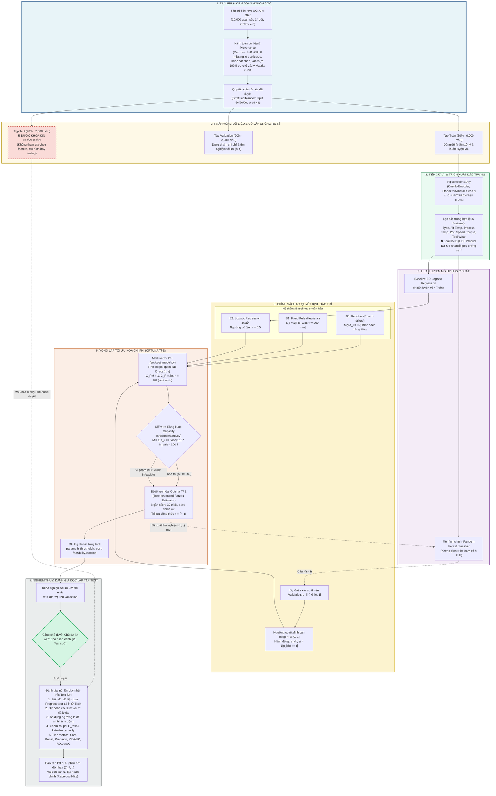

# ĐỀ CƯƠNG NGHIÊN CỨU & MÔ HÌNH HÓA BÀI TOÁN

- **Tên đề tài:** Tối ưu hóa chi phí bảo trì dự đoán bằng Machine Learning trên thiết bị gia công công nghiệp
- **Dự án:** Predictive Maintenance Cost Optimization
- **Nhiệm vụ:** W1-G1-A (Tuần 1 – Giai đoạn 1: Phân tích đề tài và mô hình hóa bài toán)
- **Tác giả phụ trách:** Antigravity (theo phân quyền `AGENTS.md`)
- **Ngày hoàn thiện:** 2026-10-22 (Asia/Saigon)
- **Căn cứ pháp lý & kỹ thuật:** Quyết định phê duyệt A1–A7 của Chủ dự án (2026-10-21), [PROJECT_SPEC PR #1](https://github.com/PhucHuynh16/Predictive-maintenance-cost-optimization/pull/1), Review mô hình hóa [Codex PR #3](https://github.com/PhucHuynh16/Predictive-maintenance-cost-optimization/pull/3), và Báo cáo kiểm toán dữ liệu [Issue #2](https://github.com/PhucHuynh16/Predictive-maintenance-cost-optimization/issues/2).

---

## 1. Tên Đề Tài & Bối Cảnh Thực Tế

Trong môi trường sản xuất công nghiệp 4.0 hiện đại, sự ổn định liên tục của thiết bị máy móc (như máy phay CNC, máy tiện, hệ thống truyền động) là yếu tố sống còn quyết định năng suất và chi phí của nhà máy. Trong thực tế vận hành, hai chiến lược bảo trì truyền thống bộc lộ những khiếm khuyết lớn:
1. **Bảo trì phục hồi / phản ứng (Reactive Maintenance / Run-to-failure):** Chỉ sửa chữa khi máy móc đã gặp sự cố dừng đột ngột. Cách tiếp cận này gây thiệt hại nặng nề do đình trệ dây chuyền, hỏng hóc lan truyền và chi phí sửa chữa khẩn cấp rất đắt đỏ ($C_F$).
2. **Bảo trì phòng ngừa định kỳ theo thời gian (Time-based Preventive Maintenance):** Tiến hành bảo trì/thay thế linh kiện theo khoảng thời gian cố định bất kể tình trạng cơ khí thực tế. Cách làm này gây lãng phí nhân lực kỹ thuật, chi phí phụ tùng thay mới sớm ($C_{PM}$) và lãng phí thời gian dừng máy hữu ích.

**Bảo trì dự đoán (Predictive Maintenance - PdM)** ra đời nhằm giải quyết nghịch lý trên bằng cách thu thập tín hiệu cảm biến IoT (nhiệt độ, tốc độ quay, mô-men xoắn, độ mòn tích lũy) để giám sát trạng thái thời gian thực, dự báo sớm nguy cơ hỏng hóc và đưa ra quyết định can thiệp bảo trì chủ động trước khi sự cố xảy ra.

---

## 2. Vấn Đề Nghiên Cứu: Tại Sao Cần Tối Ưu Chi Phí Bảo Trì?

Phần lớn các nghiên cứu Machine Learning áp dụng cho PdM hiện nay chỉ tập trung thuần túy vào việc tối ưu hóa các độ đo thống kê phân loại chuẩn (như Accuracy, F1-score, ROC-AUC, Log-loss) với giả định ngầm rằng chi phí sai lầm là đối xứng hoặc sử dụng ngưỡng phân loại mặc định $\tau = 0.5$. Tuy nhiên, trong môi trường vận hành công nghiệp thực tế:
- **Chi phí sai lầm bất đối xứng nghiêm trọng:** Bỏ sót một sự cố máy móc (False Negative - FN) gây tổn thất chi phí ngừng trệ dây chuyền ($C_F$) lớn gấp nhiều lần chi phí kiểm tra phòng ngừa không cần thiết (False Positive - FP, tốn $C_{PM}$). Cụ thể trong đề tài này, tỷ số tổn thất là $C_F / C_{PM} = 20 / 1$.
- **Ràng buộc năng lực nguồn lực hữu hạn (Capacity Constraint):** Đội ngũ kỹ thuật viên bảo trì và quỹ thời gian dừng máy trong mỗi kỳ vận hành bị khống chế nghiêm ngặt (không thể vượt quá tỷ lệ năng lực $b = 10\%$ tổng số quan sát thiết bị).
- **Mối quan hệ giữa ML và Tối ưu hóa:** Mô hình ML dự đoán xác suất rủi ro hỏng hóc $p_i$, nhưng việc chuyển từ xác suất sang hành động can thiệp $a_i \in \{0, 1\}$ đòi hỏi phải lựa chọn một ngưỡng quyết định $\tau$. Một ngưỡng cố định $\tau = 0.5$ thường làm vi phạm ràng buộc năng lực hoặc không tối thiểu hóa tổn thất kinh tế.

Do đó, vấn đề nghiên cứu cốt lõi của đề tài là: **Thiết lập mô hình tối ưu hóa đồng thời cấu hình siêu tham số Machine Learning và ngưỡng quyết định can thiệp $x = (h, \tau)$ nhằm tối thiểu hóa tổng chi phí vận hành mô phỏng dưới ràng buộc năng lực bảo trì nghiêm ngặt.**

---

## 3. Mục Tiêu Nghiên Cứu

### 3.1. Mục tiêu tổng quát
Xây dựng khung phương pháp luận khoa học và quy trình thực nghiệm (pipeline) khép kín, tích hợp chặt chẽ giữa mô hình phân loại xác suất Machine Learning và thuật toán tối ưu hóa toán học, giải quyết bài toán ra quyết định bảo trì phòng ngừa chi phí tối thiểu dưới ràng buộc giới hạn năng lực.

### 3.2. Mục tiêu cụ thể
1. **Kiểm toán dữ liệu & Chống rò rỉ (Data Integrity & Anti-Leakage):** Khảo sát, kiểm toán toàn diện tập dữ liệu chuẩn UCI AI4I 2020, làm rõ cơ chế vật lý sinh dữ liệu, nhận diện các dị thường và thiết lập ranh giới phân tách dữ liệu Train/Validation/Test nghiêm ngặt chống rò rỉ dữ liệu.
2. **Mô hình hóa bài toán & Hàm chi phí (Formulation & Cost Modeling):** Thiết lập công thức hàm mục tiêu chi phí quan sát $C_{obs}(h, \tau)$, ràng buộc năng lực $M \le \lfloor b \cdot N \rfloor$, và bộ ca kiểm thử đơn vị (unit tests) tính tay chính xác.
3. **Xây dựng hệ thống Baseline đối chuẩn:** Thiết lập 3 phương pháp đối chuẩn khách quan gồm B0 (Reactive), B1 (Fixed Rule theo Tool wear) và B2 (Logistic Regression chuẩn với $\tau = 0.5$).
4. **Tối ưu hóa chính sách đề xuất (Proposed Optimization Method):** Tích hợp mô hình Random Forest với thuật toán tối ưu Bayes/Tree-structured Parzen Estimator (Optuna TPE) để tìm kiếm cặp nghiệm tối ưu $x^* = (h^*, \tau^*)$ trên tập Validation.
5. **Phân tích độ nhạy & Kiểm chứng độc lập:** Đánh giá độ bền vững (robustness) của chính sách trước biến thiên thông số kinh tế ($C_F, \eta$), kiểm chứng đa hạt giống (multi-seed) và đánh giá một lần duy nhất trên tập Test được khóa kín để chứng minh tính tái lập.

---

## 4. Câu Hỏi Nghiên Cứu Chính (Research Questions)

- **RQ1:** Việc kết hợp mô hình phân loại Random Forest với thuật toán tối ưu hóa ngưỡng dựa trên chi phí $\tau^*$ có giúp giảm tổng chi phí vận hành đáng kể so với chính sách phản ứng B0 và các heuristic công nghiệp truyền thống (B1, B2) dưới cùng ràng buộc năng lực hay không?
- **RQ2:** Việc tối ưu hóa đồng thời siêu tham số mô hình và ngưỡng quyết định $x = (h, \tau)$ qua Optuna TPE mang lại lợi ích giảm chi phí như thế nào so với việc chỉ tối ưu ngưỡng $\tau$ trên một mô hình cố định?
- **RQ3:** Chính sách bảo trì tối ưu thể hiện độ bền vững và khả năng đáp ứng ràng buộc ra sao trước sự thay đổi của tỷ lệ chi phí tổn thất sự cố $C_F \in \{5, 10, 20, 40\}$ và hiệu quả can thiệp $\eta \in \{0.7, 0.8, 1.0\}$?

---

## 5. Dữ Liệu AI4I 2020: Nguồn Gốc & Đặc Điểm Thực Nghiệm

- **Nguồn gốc:** Tập dữ liệu *AI4I 2020 Predictive Maintenance Dataset*, lưu trữ trên UCI Machine Learning Repository (DOI: [10.24432/C5HS5C](https://doi.org/10.24432/C5HS5C)), công bố bởi tác giả Stephan Matzka (2020). Giấy phép: [CC BY 4.0](https://creativecommons.org/licenses/by/4.0/).
- **Quy mô & Chất lượng:** 10,000 quan sát thực nghiệm, 14 cột dữ liệu, **0 giá trị khuyết thiếu (missing values)**, 0 dòng trùng lặp. Mã băm mật mã học SHA-256 tệp raw `data/raw/ai4i2020.csv`: `dc6630cd9b1f0f853922fad78a1b6436570d3f1ec863f1dd5c4340ac56bc8a8e`.
- **Nhãn mục tiêu chính (`Machine failure`):**
  - Lớp 0 (Bình thường): 9,661 quan sát (96.61%).
  - Lớp 1 (Sự cố máy): 339 quan sát (3.39%).
  - Mất cân bằng lớp nghiêm trọng (Severe Imbalance) với tỷ số xấp xỉ **28.5 : 1**.
- **Năm chế độ hỏng hóc độc lập (Sub-failures):** `TWF` (46 ca), `HDF` (115 ca), `PWF` (95 ca), `OSF` (98 ca), `RNF` (19 ca).
- **Phát hiện kiểm toán dữ liệu then chốt:**
  - Có 9 quan sát có `Machine failure = 1` nhưng toàn bộ 5 nhãn phụ bằng 0.
  - Có 18 quan sát có `RNF = 1` nhưng `Machine failure = 0` (sự cố ngẫu nhiên làm gián đoạn chu kỳ gia công nhưng không làm hỏng máy). Toàn bộ 10,000 nhãn gốc được giữ nguyên trạng thái nguyên bản để đảm bảo liêm chính học thuật.
  - **Cụm nhiệt độ chu kỳ:** 108/115 ca HDF tập trung tại dải quan sát UDI 4000–4999 do quá trình mô phỏng sóng nhiệt môi trường. Nếu chia tập tuần tự theo thời gian, tập Test sẽ không có bất kỳ ca HDF nào. Do đó, cần áp dụng **Stratified Random Split** (tỷ lệ 60% Train, 20% Validation, 20% Test, phân tầng theo nhãn chính `Machine failure`, seed 42) để bảo đảm đại diện phân bố trên cả 3 tập.

---

## 6. Đầu Vào (Inputs) & Đầu Ra (Outputs) Của Bài Toán

### 6.1. Đầu vào (Inputs)
Gồm 6 đặc trưng vận hành vật lý của thiết bị được phép sử dụng:
1. `Type`: Cấp chất lượng biến thể sản phẩm (Categorical: L=Low 60%, M=Medium 30%, H=High 10%).
2. `Air temperature [K]`: Nhiệt độ không khí xung quanh máy (Liên tục: 295.3 – 304.5 K).
3. `Process temperature [K]`: Nhiệt độ quá trình gia công cơ học (Liên tục: 305.7 – 313.8 K).
4. `Rotational speed [rpm]`: Vận tốc quay trục chính (Liên tục: 1168 – 2886 rpm, độ lệch dương cao).
5. `Torque [Nm]`: Mô-men xoắn chịu tải (Liên tục: 3.8 – 76.6 Nm).
6. `Tool wear [min]`: Thời gian mòn dụng cụ tích lũy (Rời rạc/liên tục: 0 – 253 phút).

> [!CAUTION]
> **Loại trừ tuyệt đối chống Target & Identifier Leakage:** Loại bỏ hoàn toàn `UDI` (bộ đếm thứ tự), `Product ID` (mã hiệu sản phẩm) và 5 cột nhãn phụ `TWF`, `HDF`, `PWF`, `OSF`, `RNF`. Các nhãn phụ là nguyên nhân sau sự cố, nếu đưa vào feature sẽ gây rò rỉ nhãn 100%.

### 6.2. Đầu ra (Outputs)
- **Ước lượng rủi ro:** Vector xác suất hỏng hóc $p_i(h) \in [0, 1]$ cho mỗi quan sát $i$.
- **Hành động quyết định:** Vector nhị phân $a_i(h, \tau) \in \{0, 1\}$, trong đó $a_i = 1$ biểu thị chỉ định thực hiện bảo trì phòng ngừa.
- **Đánh giá kinh tế:** Tổng chi phí quan sát mô phỏng $C_{obs}(h, \tau)$ và chi phí trung bình trên mỗi quan sát.
- **Trạng thái ràng buộc:** Đánh giá tính khả thi (`Feasible` vs `Infeasible`) và độ vi phạm năng lực `capacity_excess`.

---

## 7. Biến Quyết Định & Không Gian Tìm Kiếm

Không gian biến quyết định của bài toán là cặp tham số:
$$x = (h, \tau)$$

1. **Siêu tham số mô hình ($h \in \mathcal{H}$):** Cấu hình của thuật toán Random Forest Classifier, fit trên tập Train. Không gian tìm kiếm $\mathcal{H}$ đề xuất gồm 4 siêu tham số phân loại:
   - `n_estimators` $\in \{100, 200, 300\}$
   - `max_depth` $\in \{5, 10, 20, \text{None}\}$
   - `min_samples_leaf` $\in \{1, 2, 5, 10\}$
   - `max_features` $\in \{\text{"sqrt"}, 0.75, 1.0\}$
   *(Gồm 144 tổ hợp danh nghĩa; các tham số còn lại của Random Forest được giữ cố định).*
2. **Ngưỡng quyết định can thiệp ($\tau \in [0, 1]$):** Giá trị ngưỡng xác suất để kích hoạt hành động bảo trì theo quy tắc toán tử so sánh cố định $\ge$:
   $$a_i(h, \tau) = \mathbb{I}[p_i(h) \ge \tau]$$

---

## 8. Hàm Mục Tiêu Đã Phê Duyệt (Objective Function)

Hàm mục tiêu chi phí quan sát mô phỏng ($C_{obs}$) trên tập đánh giá quy mô $N$ quan sát được xác định theo công thức:
$$\min_{x = (h, \tau)} C_{obs}(h, \tau) = \sum_{i=1}^{N} \left[ C_{PM} \cdot a_i(h, \tau) + C_F \cdot y_i \cdot (1 - \eta \cdot a_i(h, \tau)) \right]$$

### Các tham số kinh tế đã được Chủ dự án phê duyệt:
- $C_{PM} = 1\text{ cost unit}$: Chi phí thực hiện một hành động bảo trì phòng ngừa (trả cho mọi $a_i = 1$).
- $C_F = 20\text{ cost units}$: Tổn thất sự cố toàn phần khi máy hỏng mà không có can thiệp phòng ngừa ($y_i = 1, a_i = 0$).
- $\eta = 0.8$: Hệ số hiệu quả tránh tổn thất giả định khi can thiệp bảo trì thành công ($y_i = 1, a_i = 1$). Khi đó tổn thất sự cố còn lại là $(1 - \eta) C_F = 0.2 \times 20 = 4\text{ cost units}$, cộng chi phí thực hiện $C_{PM} = 1$ thành $5\text{ cost units}$.
- **Đơn vị tính:** *cost units* (đơn vị chi phí mô phỏng quy chuẩn, không phải tiền tệ VND thực tế).

### Bảng đối chiếu chi phí đơn lẻ $c_{obs}(y_i, a_i)$:
| $y_i$ (Thực tế) | $a_i$ (Quyết định) | Trạng thái kỹ thuật | Chi phí phát sinh $c_{obs}$ (cost units) |
|:---:|:---:|---|:---:|
| 0 | 0 | Đúng âm (True Negative): Bình thường, không bảo trì | **0** |
| 0 | 1 | Sai dương (False Positive): Bảo trì không cần thiết | $C_{PM} = \mathbf{1}$ |
| 1 | 0 | Sai âm (False Negative): Bỏ sót sự cố hỏng hóc | $C_F = \mathbf{20}$ |
| 1 | 1 | Đúng dương (True Positive): Bảo trì chặn lỗi kịp thời | $C_{PM} + (1 - \eta) C_F = 1 + 4 = \mathbf{5}$ |

Đặt $M = \sum a_i$ (tổng số hành động bảo trì), $P = \sum y_i$ (tổng số ca lỗi thực tế), $TP = \sum y_i a_i$ (số ca lỗi được can thiệp):
$$C_{obs} = C_{PM} \cdot M + C_F \cdot P - \eta \cdot C_F \cdot TP = M + 20 \cdot P - 16 \cdot TP$$

> [!NOTE]
> Hàm chi phí kỳ vọng $C_{exp}(h, \tau) = \sum [C_{PM} a_i + C_F p_i (1 - \eta a_i)]$ chỉ sử dụng như một chỉ số chẩn đoán xác suất nội bộ, tuyệt đối không tráo đổi với $C_{obs}$ trong hàm mục tiêu tối ưu.

---

## 9. Ràng Buộc Năng Lực Bảo Trì (Capacity Constraint)

Số lượng hành động can thiệp bảo trì tối đa trong mỗi kỳ bị giới hạn bởi năng lực nhân sự và thời gian dừng máy của xưởng sản xuất:
$$M = \sum_{i=1}^{N} a_i(h, \tau) \le K = \lfloor b \cdot N \rfloor$$

- **Tham số đã duyệt:** Tỷ lệ năng lực $b = 0.10$ (10% quy mô tập quan sát).
- Trên tập Validation ($N = 2,000$ mẫu): $K = \lfloor 0.10 \times 2,000 \rfloor = 200$ hành động bảo trì.
- **Quy tắc khả thi (Feasibility):**
  - Nếu $M \le K$: Chính sách đạt trạng thái `Feasible`.
  - Nếu $M > K$: Chính sách bị đánh dấu `Infeasible`, ghi nhận lượng vi phạm `capacity_excess = M - K` và `capacity_excess_rate = (M - K) / N`. Mọi cấu hình Infeasible bị loại khỏi danh sách nghiệm tối ưu.
- **Quy định về Recall:** Recall được xác định là một **chỉ số đánh giá kết quả (evaluation metric)**, **KHÔNG PHẢI là ràng buộc cứng (hard constraint)**. Không áp đặt ngưỡng $R_{min}$ hay hàm phạt (penalty) làm biến dạng bài toán.

---

## 10. Hệ Thống Baseline & Phương Pháp Tối Ưu Đề Xuất

| Ký hiệu | Tên phương pháp | Nguyên lý hoạt động | Điều kiện đánh giá |
|:---:|---|---|---|
| **B0** | **Reactive Baseline** | Chính sách thuần phản ứng: Mọi $a_i = 0$. Không can thiệp trước lỗi. | Là chính sách độc lập, cùng đánh giá qua hàm chi phí $C_{obs} = 20 \cdot P$. |
| **B1** | **Fixed Rule Baseline** | Heuristic công nghiệp dựa trên độ mòn dao tích lũy: $a_i = \mathbb{I}[\text{Tool wear [min]} \ge w]$, với mốc đề xuất $w = 200$ phút. | Cố định trước thực nghiệm, không tuning trên Test. Báo cáo cả tính khả thi. |
| **B2** | **ML Standard Baseline** | Mô hình Logistic Regression chuẩn với ngưỡng xác suất mặc định $\tau = 0.5$. | Tiền xử lý fit trên Train; kiểm tra capacity sòng phẳng. |
| **P** | **Proposed Method** | Random Forest kết hợp thuật toán tối ưu hóa Bayes **Optuna TPE** tìm kiếm đồng thời $x^* = (h^*, \tau^*)$. | Ngân sách ban đầu 30 trials, seed 42. Tối ưu trên Validation. |

---

## 11. Quy Trình Thực Nghiệm, Chống Rò Rỉ Dữ Liệu & Bộ Metrics

### 11.1. Quy trình thực nghiệm & Cơ chế chống rò rỉ dữ liệu (Anti-Leakage Protocol)
1. **Chia dữ liệu cố định:** Tập dữ liệu 10,000 dòng được chia tách bằng **Stratified Random Split** theo tỷ lệ **60% Train (6,000 dòng), 20% Validation (2,000 dòng), 20% Test (2,000 dòng)** với seed cố định là 42.
2. **Nguyên tắc cô lập tuyệt đối:**
   - Pipeline tiền xử lý (One-hot encoding cho `Type`, chuẩn hóa thang đo Scaler cho các biến liên tục) **CHỈ ĐƯỢC FIT TRÊN TẬP TRAIN**. Sau đó áp dụng transform lên Validation và Test.
   - Tập Test được **khóa kín tuyệt đối (Locked Test Set)** trong toàn bộ quá trình phát triển, lựa chọn feature, tinh chỉnh siêu tham số và chạy các vòng lặp tối ưu hóa.
   - Tập Test chỉ được mở một lần duy nhất ở giai đoạn nghiệm thu cuối cùng sau khi chính sách tối ưu $x^*$ đã được đóng băng và có sự phê duyệt riêng của Chủ dự án.

### 11.2. Bộ chỉ số đánh giá (Evaluation Metrics)
- **Nhóm chỉ số kinh tế & tối ưu hóa:** `total_cost` ($C_{obs}$), `cost_per_observation`, `n_maintenance` ($M$), `maintenance_rate` ($M/N$), `feasible` (True/False), `capacity_excess`, `cost_saving` so với B0 ($C_{B0} - C_{policy}$).
- **Nhóm chỉ số chất lượng mô hình Machine Learning:** Recall, Precision, F1-score, PR-AUC (Average Precision), ROC-AUC, Brier score (đo lường độ chuẩn định xác suất Calibration), Thời gian thực thi (Runtime).

---

## 12. Sơ Đồ Pipeline Phương Pháp Luận & Thực Nghiệm

Dưới đây là sơ đồ chi tiết mối quan hệ giữa dữ liệu, mô hình học máy và vòng lặp tối ưu hóa chi phí (nguồn lưu tại `figures/pipeline.mmd`):

---

## 13. Kế Hoạch Triển Khai 5 Tuần (10 Giai Đoạn)

| Tuần | Giai đoạn | Mã nhiệm vụ | Nội dung thực hiện chính | Đầu ra bàn giao | AI phụ trách |
|:---:|:---:|:---:|---|---|:---:|
| **Tuần 1** | G1: Phân tích & Mô hình hóa | W1-G1-C W1-G1-A | Review mô hình hóa bài toán, API cost/constraints, viết đề cương nghiên cứu và sơ đồ pipeline. | `docs/project_proposal.md` `docs/problem_formulation.md` `figures/pipeline.*` | Codex Antigravity |
| **Tuần 1–2** | G2: Dữ liệu & EDA | W1-G2-A | Kiểm toán dữ liệu raw UCI AI4I, xác thực SHA-256, từ điển dữ liệu, kiểm chứng cơ chế vật lý và sinh biểu đồ EDA. | `docs/data_dictionary.md` `docs/eda_findings.md` `notebooks/01_eda.ipynb` `figures/eda/**` | Antigravity |
| **Tuần 2** | G3: Pipeline & Split | W2-G3-C | Xây dựng pipeline dữ liệu chuẩn hóa, tạo split cố định 60/20/20 seed 42 chống rò rỉ, viết unit tests pipeline. | `src/data.py` `src/preprocessing.py` `tests/test_data_pipeline.py` | Codex |
| **Tuần 2** | G4: Baselines | W2-G4-C W2-G4-A | Triển khai và đánh giá các baseline B0, B1, B2 theo cost/capacity đã duyệt; trực quan hóa so sánh ban đầu. | `src/baselines.py` `scripts/run_baselines.py` `notebooks/02_baselines.ipynb` | Codex Antigravity |
| **Tuần 3** | G5: ML & Calibration | W3-G5-C | Huấn luyện mô hình xác suất Logistic Regression, Random Forest; đánh giá calibration trên train folds. | `src/models.py` `src/calibration.py` `tests/test_models.py` | Codex |
| **Tuần 3** | G6: Cost & Constraints | W3-G6-C | Hoàn thiện module tính chi phí, kiểm tra capacity và bộ unit tests tính tay 40 ca kiểm thử. | `src/cost_model.py` `src/constraints.py` `tests/test_cost_model.py` | Codex |
| **Tuần 3** | G7: Tối ưu chính | W3-G7-C W3-G7-A | Triển khai Optuna TPE (30 trials, seed 42) tìm $x^*=(h^*, \tau^*)$; phân tích đường cong hội tụ tối ưu. | `src/optimization.py` `scripts/run_optimization.py` `notebooks/03_optimization.ipynb` | Codex Antigravity |
| **Tuần 4** | G8: Thực nghiệm & Đối chiếu | W4-G8-C W4-G8-A | Chạy so sánh toàn diện, phân tích độ nhạy $C_F \in \{5,10,20,40\}$, $\eta \in \{0.7,0.8,1.0\}$, multi-seed và ablation. | `scripts/run_experiments.py` `docs/results_analysis.md` `notebooks/04_results.ipynb` | Codex Antigravity |
| **Tuần 5** | G9: Báo cáo & Demo | W5-G9-A | Soạn thảo báo cáo học thuật đầy đủ 8–12 trang, thiết kế slide bảo vệ 5–8 trang và ứng dụng demo trực quan. | `report/**` `slides/**` `scripts/demo.py` | Antigravity |
| **Tuần 5** | G10: Nghiệm thu & Tái lập | W5-G10-C W5-G10-A | Đánh giá một lần duy nhất trên Test set đã khóa; kiểm chứng khả năng tái lập toàn bộ kết quả đồ án. | `scripts/reproduce_results.py` `docs/reproducibility.md` `results/final_test_results.json` | Codex Antigravity |

---

## 14. Phạm Vi, Giả Định & Giới Hạn Nghiên Cứu

### 14.1. Phân định rõ ràng giữa Quyết định Đã Duyệt và Chi tiết Còn Chờ Duyệt (A1–A7)
- **Đã phê duyệt:**
  - $C_{PM} = 1\text{ cost unit}$, $C_F = 20\text{ cost units}$, $\eta = 0.8$. Đơn vị tính: *cost units*.
  - Tỷ lệ năng lực bảo trì $b = 0.10$ ($M \le \lfloor 0.10 \cdot N \rfloor$). Recall là metric, không phải constraint.
  - Baseline B0 là chính sách phản ứng riêng biệt (mọi $a_i = 0$).
  - Thuật toán chính: Random Forest kết hợp Optuna TPE, ngân sách 30 trials, seed chính 42.
  - Phân vùng dữ liệu: Stratified Random Split 60/20/20, seed 42, fit tiền xử lý chỉ trên Train, khóa kín tập Test.
- **Chi tiết còn chờ Chủ dự án phê duyệt cụ thể trước khi triển khai code (A2–A6):**
  - *A2 (Thiết kế sensitivity):* Chốt phương án quét toàn bộ 12 tổ hợp Descartes $C_F \times \eta$ hay quét từng yếu tố độc lập; đánh giá trên policy cố định hay tối ưu hóa lại.
  - *A3 (Quy ước biên & Candidate thresholds):* Chốt tập ngưỡng ứng viên $\mathcal{T}(p) = \{0, 1\} \cup \text{unique}(p_i)$, quy tắc hòa chi phí (ưu tiên $M$ nhỏ hơn, $\tau$ lớn hơn) và xử lý tập dữ liệu không có nhãn dương ($P = 0$).
  - *A4 (Không gian H):* Phê duyệt chính thức danh mục 4 siêu tham số của Random Forest và các tham số cố định.
  - *A5 (Xử lý phơi nhiễm dữ liệu & Calibration):* Phê duyệt chính thức phương pháp chuẩn định xác suất (Sigmoid với 5 folds trên Train) và protocol mở khóa Test cuối cùng.
  - *A6 (Chi tiết Baseline B1 & B2):* Phê duyệt chính thức mốc ngưỡng $w = 200$ phút cho B1 và cấu hình pipeline Logistic Regression cho B2.

### 14.2. Giả định & Giới hạn nghiên cứu
1. **Bản chất dữ liệu tổng hợp (Synthetic Data Disclaimer):** Bộ dữ liệu AI4I 2020 là dữ liệu mô phỏng công nghiệp. Toàn bộ các thông số chi phí ($C_{PM}, C_F$), hiệu quả $\eta$ và các con số tiết kiệm chi phí tính toán trong đồ án này mang bản chất **mô phỏng học thuật (simulated cost units)**, tuyệt đối không đại diện cho chi phí tài chính hay hiệu quả bảo trì bằng tiền tệ thực tế tại một nhà máy cụ thể.
2. **Mô hình đánh giá đơn kỳ (Single-period Evaluation):** Mỗi dòng dữ liệu được xem là một quan sát vận hành độc lập trong một kỳ đánh giá tĩnh. Mô hình hiện tại chưa bao gồm động thái suy giảm theo thời gian liên tục (degradation trajectories), quản lý tồn kho linh kiện phụ tùng, chi phí điều phối nhân lực theo đợt hay ràng buộc lịch trình riêng của từng máy móc đơn lẻ.
3. **Giới hạn của phân tầng đơn nhãn:** Chiến lược Stratified Random Split theo nhãn mục tiêu chính `Machine failure` chỉ bảo đảm phân bổ đồng đều tỷ lệ hỏng hóc chung giữa các tập, không bảo đảm phân bổ đều cho từng nhãn lỗi phụ hiếm gặp (như `RNF` hay `TWF`).
